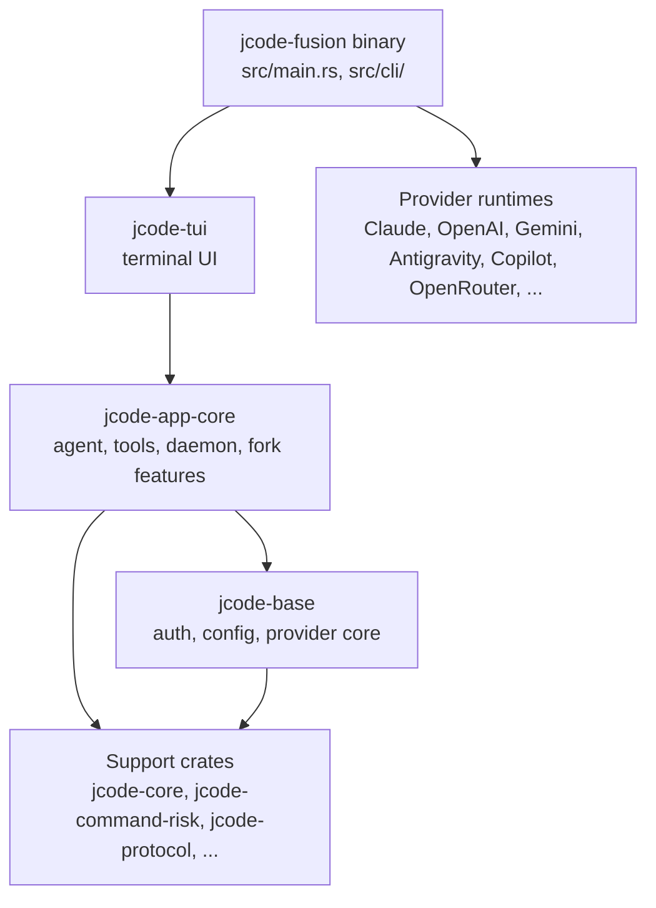

<div align="center">

# jcode-fusion

**A Rust terminal coding agent with multi-provider OAuth login, forked from [`jcode`](https://github.com/1jehuang/jcode) and extended with orchestration, safety, swarm, and memory features ported from OpenAI's [Codex Harness](https://github.com/openai/codex) and xAI's [Grok Build](https://github.com/xai-org/grok-build).**

[](LICENSE)
[](Cargo.toml)
[](#roadmap)

[Overview](#overview) · [Features](#features) · [Architecture](#architecture) · [Install](#install-and-setup) · [Usage](#usage) · [Configuration](#configuration) · [Project structure](#project-structure) · [Tests](#tests) · [Roadmap](#roadmap) · [Contributing](#contributing) · [License](#license)

</div>

---

## Overview

jcode-fusion is a fork of [jcode](https://github.com/1jehuang/jcode) v0.81.2. The base was chosen for its multi-provider login: `jcode login` authenticates against many providers through OAuth and supports several accounts per provider (`--account`), so you can use existing subscriptions without separate API billing. This fork leaves that base intact and adds nine features, each reimplemented in jcode's style rather than copied from the donor projects.

The fork is paused. The code builds once a missing asset is added (see [Build from source](#build-from-source)), and it has unit tests. Several features are opt-in, have documented limitations, or have not been exercised against a live daemon or a real provider. The [Features](#features) table says which is which. Design rationale is in [`DESIGN.md`](DESIGN.md); the phase-by-phase build log is in [`PROGRESS.md`](PROGRESS.md).

## Features

Each row says whether the feature is on by default and what it does *not* cover. Items marked **opt-in** only activate when you set the listed environment variable or file.

| Feature | Ported from | Default | What it does | Limits |
|---|---|---|---|---|
| **Mission engine** (`mission` tool) | Codex Harness, Grok Build | On | Tracks a mission's status, token and wall-clock budget, checkpoints, and success criteria. An agent can *claim* completion, but the claim only succeeds after `verify_completion` checks the recorded evidence against the success criteria. | The verifier is a structural check (does the evidence cover the criteria?), not an independent LLM review. The same session can call it. |
| **Rewind** (`/rewind`) | Grok Build | On | Keeps a persisted, multi-level rewind stack. Each snapshot is verified against its SHA-256 hash before it is restored; a corrupt snapshot is refused rather than applied. | Covers conversation state only. File writes made by tools are not reverted. |
| **Guardian** | Codex Harness | On for ambient-mode permission requests | A keyword-based judge for permission requests raised in ambient mode. It can deny a request outright or defer it to the human queue. | Deny-only: it never auto-approves. Interactive tool calls do not pass through it. |
| **macOS sandbox** | Codex Harness | **Opt-in**: `JCODE_FUSION_SANDBOX=1` | Re-executes the whole binary under `sandbox-exec`, so in-process file tools and subprocesses are both covered. Writes to credential paths (`~/.ssh`, `~/.aws`, `~/.gnupg`, `~/.kube`, `~/.docker`, `~/.netrc`, and others) are denied. | macOS only. Allow-by-default with a deny list, not an allow-list. Fails open if the sandbox cannot be applied. |
| **Execpolicy** | Codex Harness | **Opt-in**: `~/.jcode/execpolicy.star` | Lets you add `confirm` or `deny` rules for bash command prefixes, on top of jcode's built-in risk classifier. | Rules can only tighten a verdict. There is no `allow` decision, and the rule format is a plain `"prefix\|decision\|reason"` list rather than a full Starlark API. |
| **Worktree-per-subagent** | Codex Harness, Grok Build | **Opt-in**: `JCODE_FUSION_SWARM_WORKTREES=1` | Each spawned swarm agent gets its own git worktree. The `apply` action merges a worker's commits back into the coordinator's tree with `git merge`. | No automated conflict resolution yet. |
| **Full ACP** (`acp` subcommand) | Grok Build | On | Runs an Agent Client Protocol adapter backed by the jcode daemon. Session lifecycle, session-scoped MCP servers, and client callbacks are implemented. With an ACP client connected, file reads and writes can go through the editor's buffer. | The file-routing wire format has not been checked against a real ACP host. |
| **Workflow tool** (`workflow`) | Grok Build | On | Saves, lists, and runs reusable, parameterized multi-agent task graphs (`save`, `list`, `run`). | `run` seeds the graph through the daemon. That round trip has not yet been exercised against a live daemon. Templates have no scripting layer and no versioning. |
| **Two-phase memory consolidation** | Codex Harness | **Opt-in**: `JCODE_FUSION_MEMORY_CONSOLIDATION=1` (ambient extraction); `JCODE_FUSION_MEMORY_MD=1` (global `MEMORY.md`) | Leased extraction jobs per session with retry backoff, then a locked-write consolidator that renders a global `MEMORY.md`. | Global `MEMORY.md` only, not per project, and no git-commit step. The interactive-exit extraction path predates the fork and runs without the variable, so the two triggers can extract the same session twice. |

The full rationale for each feature, including what was rejected and why, is in [`DESIGN.md`](DESIGN.md) §6.

## Architecture

The workspace is a layered set of Rust crates. The binary sits on top of the TUI, which sits on the application core, which sits on the base crate (auth, config, and provider core). Provider runtimes are separate crates that the binary registers at startup, so editing one does not rebuild the base → app-core → TUI stack.



Fork-specific code lives mainly in `crates/jcode-app-core/src/`:

| Module | Feature |
|---|---|
| `mission.rs`, `tool/mission.rs` | Mission engine |
| `rewind_store.rs` | Rewind stack |
| `guardian.rs` | Guardian |
| `sandbox_macos.rs` | macOS sandbox |
| `execpolicy.rs`, `tool/bash_destructive_gate.rs` | Execpolicy |
| `swarm_worktree.rs` | Worktree isolation |
| `workflow_template.rs`, `tool/workflow.rs` | Workflow tool |
| `memory_consolidation.rs`, `memory_consolidator.rs` | Memory consolidation |

Runtime state lives in a long-lived background daemon (`jcode-fusion server start`, managed with `server stop` and `server reload`). The TUI and ACP clients connect to it over a Unix socket. See [`docs/SERVER_ARCHITECTURE.md`](docs/SERVER_ARCHITECTURE.md) and [`docs/SWARM_ARCHITECTURE.md`](docs/SWARM_ARCHITECTURE.md).

## Install and setup

### Prerequisites

- A Rust toolchain with edition 2024 support (Rust 1.85 or newer), installed with [rustup](https://rustup.rs).
- A C compiler. Some dependencies, such as `aws-lc-sys`, build C code.
- Git.

This fork has been built and run on macOS. The macOS sandbox is macOS-only, and the other platform paths are not verified here.

### Build from source

```bash
git clone https://github.com/tirthfx/jcode-fusion.git
cd jcode-fusion
cargo build --bin jcode-fusion
./target/debug/jcode-fusion --help
```

> **Known build issue on macOS.** `crates/jcode-setup-hints/src/macos_launcher.rs` embeds `assets/app-icons/Jcode.icns` with `include_bytes!`, but no `assets/` directory is committed to this repository, so `cargo build` stops with `couldn't read .../assets/app-icons/Jcode.icns`. Until the file is added, copy it from [upstream jcode](https://github.com/1jehuang/jcode/blob/master/assets/app-icons/Jcode.icns) to that path before building.

The first build compiles several hundred crates, including the AWS SDK for Bedrock and the local embedding stack, and takes a long time. The default features are `pdf`, `embeddings`, and `bedrock`.

> **Do not use `scripts/install.sh` or `scripts/install.ps1` from this repo to install jcode-fusion.** Those scripts download release binaries of upstream jcode from `1jehuang/jcode`, not this fork.

### Log in to a provider

jcode-fusion has no API keys of its own. Log in to the providers you already have access to:

```bash
./target/debug/jcode-fusion login
./target/debug/jcode-fusion login claude
./target/debug/jcode-fusion auth status
```

The `--provider` choices come from [`src/cli/provider_init.rs`](src/cli/provider_init.rs). They include Claude, OpenAI, Gemini, Antigravity, OpenRouter, AWS Bedrock, GitHub Copilot, Ollama, LM Studio, and any OpenAI-compatible endpoint. Use `--account <label>` to store several accounts for one provider.

## Usage

Run a one-shot prompt. This needs a logged-in provider. Without one, the command exits with `No credentials configured for provider auto-detection`:

```bash
./target/debug/jcode-fusion run "Find the function that parses config.toml and explain its error handling"
```

With no subcommand, `jcode-fusion` starts the interactive TUI. List every subcommand with `--help`:

```bash
./target/debug/jcode-fusion
./target/debug/jcode-fusion --help
```

Run as an Agent Client Protocol adapter for an editor:

```bash
./target/debug/jcode-fusion acp
```

### Turn on the opt-in features

```bash
# macOS only: run the whole process under sandbox-exec
JCODE_FUSION_SANDBOX=1 ./target/debug/jcode-fusion

# Give each swarm agent its own git worktree
JCODE_FUSION_SWARM_WORKTREES=1 ./target/debug/jcode-fusion

# Enable background memory consolidation and the global MEMORY.md
JCODE_FUSION_MEMORY_CONSOLIDATION=1 JCODE_FUSION_MEMORY_MD=1 ./target/debug/jcode-fusion
```

### Add execpolicy rules

Create `~/.jcode/execpolicy.star` (or `$JCODE_HOME/execpolicy.star`). It must define a top-level `RULES` list. Each entry is `"prefix|decision|reason"`, where `decision` is `confirm` or `deny`:

```python
RULES = [
    "curl|confirm|network fetch, may pipe to shell",
    "wget |deny| never allowed by policy",
]
```

Rules can only make a command more restricted than jcode's built-in classifier, never less.

## Configuration

Settings are read from `~/.jcode/config.toml`, or from `$JCODE_HOME/config.toml` if `JCODE_HOME` is set. If the file is missing, built-in defaults apply. The main top-level tables are:

| Table | Controls |
|---|---|
| `[provider]` | Provider defaults, including `stream_idle_timeout_secs` (default `180`) |
| `[providers.<name>]` | Named provider profiles |
| `[auth]`, `[agents]`, `[tools]`, `[websearch]` | Authentication, agent behavior, tool settings, web search |
| `[hooks]` | Lifecycle hook commands, documented in [`docs/HOOKS.md`](docs/HOOKS.md) |
| `[ambient]`, `[safety]`, `[notifications]` | Ambient mode, permission handling, push and email notifications |
| `[compaction]`, `[power]`, `[acp]`, `[gateway]` | Context compaction, power behavior, ACP and gateway settings |
| `[keybindings]`, `[display]`, `[terminal]` | TUI keys, display, and terminal behavior |

The authoritative field list is `crates/jcode-config-types/src/lib.rs`. The system prompt can be extended without rebuilding; see [`docs/SYSTEM_PROMPT_CONFIG.md`](docs/SYSTEM_PROMPT_CONFIG.md).

### Environment variables

| Variable | Effect |
|---|---|
| `JCODE_HOME` | Overrides the state directory (default `~/.jcode`) |
| `JCODE_FUSION_SANDBOX=1` | Enables the macOS sandbox |
| `JCODE_FUSION_SWARM_WORKTREES=1` | Enables per-agent git worktrees |
| `JCODE_FUSION_MEMORY_CONSOLIDATION=1` | Enables background memory consolidation |
| `JCODE_FUSION_MEMORY_MD=1` | Enables rendering of the global `MEMORY.md` |
| `JCODE_NO_TELEMETRY=1` or `DO_NOT_TRACK=1` | Disables anonymous usage telemetry |

### Telemetry

Anonymous usage telemetry is **on by default**. The telemetry code comes from upstream jcode, and it posts to a hard-coded endpoint, `https://telemetry.jcode.sh/v1/event`, which is upstream jcode's domain. This fork has not changed that endpoint, so events go there unless you opt out. Ordinary events do not contain prompts, code, or responses. To turn telemetry off, use any of these:

```bash
export JCODE_NO_TELEMETRY=1
# or
jcode-fusion telemetry disable
```

Full transcript sharing is a separate program. It is off unless you enable it, and it is described in [`TELEMETRY.md`](TELEMETRY.md).

## Project structure

```text
.
├── src/                  # binary entry point (main.rs) and CLI (src/cli/)
├── crates/               # 82 workspace crates: core, base, app-core, tui, providers, types
├── tests/                # Rust integration tests and Python socket-based test scripts
├── scripts/              # build, install, benchmark, and guardrail scripts
├── docs/                 # architecture and feature docs
├── changelog/            # per-version changelog JSON
├── sdk/                  # TypeScript SDK for the harness API
├── ios/                  # iOS app project
├── telemetry-worker/     # Cloudflare Worker for telemetry, with D1 SQL files
├── claude-code-build/    # build-session notes for the fork
├── DESIGN.md             # design rationale for every fork feature
└── PROGRESS.md           # phase-by-phase build log
```

## Tests

Unit tests run per crate. The project has about 7,700 `#[test]` functions (counted with `grep`).

```bash
# Unit tests for the application core, where most fork features live
cargo test -p jcode-app-core --lib

# A narrower run, for example just the mission engine
cargo test -p jcode-app-core --lib mission
```

Local quality gates, run before pushing:

```bash
scripts/check_guardrails.sh --skip-slow   # format, module, warning, size, and dependency checks; skips cargo check, clippy, and machete
scripts/check_guardrails.sh               # the same, plus cargo check, clippy -D warnings, and cargo machete if installed
```

`check_guardrails.sh` mirrors a CI workflow (`.github/workflows/ci.yml`) that is **not included in this fork**, so the gates run only when invoked locally.

**Current state:** on `main` at `d91f330`, the script exits non-zero. These gates fail: `cargo fmt --all --check`, the warning budget, the oversized-file and oversized-test ratchets, the panic-prone usage ratchet, and the swallowed-error ratchet. The ratchets report growth against checked-in budget files in `scripts/`, and the failure messages say to update them only after an intentional cleanup.

The Python scripts in `tests/` (`test_injection_fix.py`, `test_injection_thorough.py`, `test_selfdev_reload.py`) connect to a running jcode server through its debug socket (`jcode-debug.sock` in the runtime directory). Start a server first, then run them with `python3`.

## Roadmap

There is no published roadmap. The following items come from the project's own notes, in [`PROGRESS.md`](PROGRESS.md) and the code comments:

- **Mission verifier**: add an independent semantic check, run by a separate agent, so the session that claimed completion cannot approve it.
- **Guardian**: add the auto-approve half, which needs a semantic judge rather than keyword matching. Replace the keyword layer with a real tokenizer.
- **Sandbox**: move from the macOS deny list to an allow-list profile, and add Linux and Windows support.
- **Execpolicy**: add a resubmit-with-justification flow for user rules.
- **Swarm**: add automated conflict resolution for merge-back, and prune worktrees that were deleted outside jcode.
- **Rewind**: add an HMAC integrity check, which needs a key-management story, for example the OS keychain. Extend rewind to file writes.
- **Memory**: make `MEMORY.md` per project, and coordinate the interactive-exit and ambient extraction triggers so they do not repeat work.
- **Verification**: exercise the workflow `run` path and the ACP file routing against a live daemon and a real ACP host.
- **Providers**: the Antigravity provider returns HTTP 429 for this fork's requests while the same account works in Google's own `agy` CLI. The cause is unresolved, and [`claude-code-build/PROJECT_FINAL_SUMMARY.md`](claude-code-build/PROJECT_FINAL_SUMMARY.md) has the full investigation.

## Contributing

jcode-fusion is an independent fork, not an upstream contribution channel. The contribution guide is inherited from upstream and describes how upstream handles issues and pull requests. Read [`CONTRIBUTING.md`](CONTRIBUTING.md) before you open one.

- Open an issue for a bug or design question with clear reproduction steps.
- Keep pull requests focused and explain the problem, the approach, and the edge cases.
- Run `scripts/check_guardrails.sh --skip-slow` before you push.
- If you work with an AI coding agent on this repo, follow [`AGENTS.md`](AGENTS.md).

## Credits

- [`1jehuang/jcode`](https://github.com/1jehuang/jcode): the base harness. MIT licensed.
- [`openai/codex`](https://github.com/openai/codex) (Codex Harness): source of the Guardian, macOS sandboxing, execpolicy, and memory consolidation ideas. Apache-2.0.
- [`xai-org/grok-build`](https://github.com/xai-org/grok-build) (Grok Build): source of provable-safe rewind, full ACP support, and orchestration-as-script. Apache-2.0.

Mission engine and worktree-per-subagent isolation were built from ideas in both Codex Harness and Grok Build.

## License

MIT. See [`LICENSE`](LICENSE). The copyright line is the upstream notice, `Copyright (c) 2025 Jeremy Huang`.
