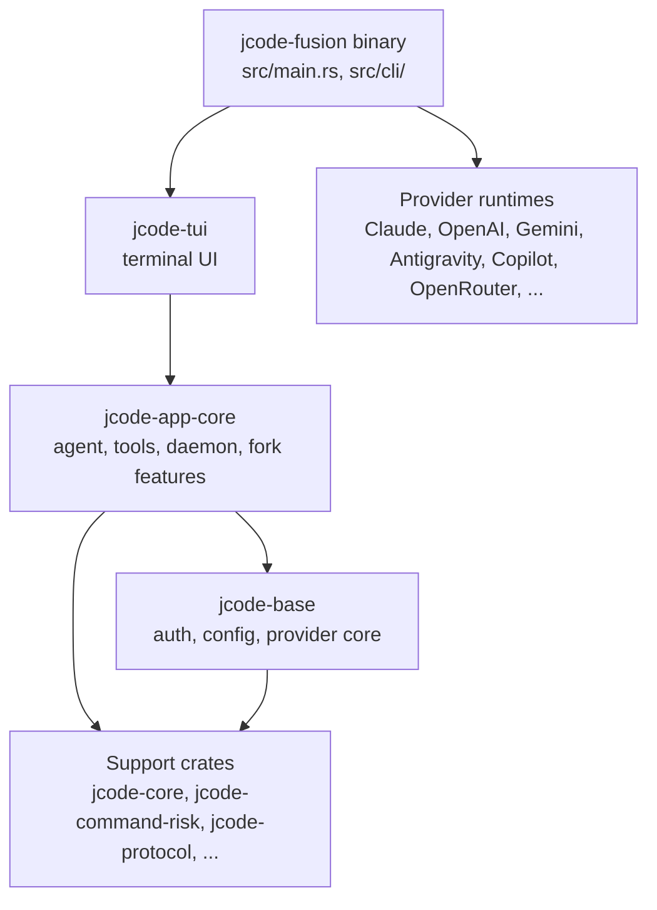
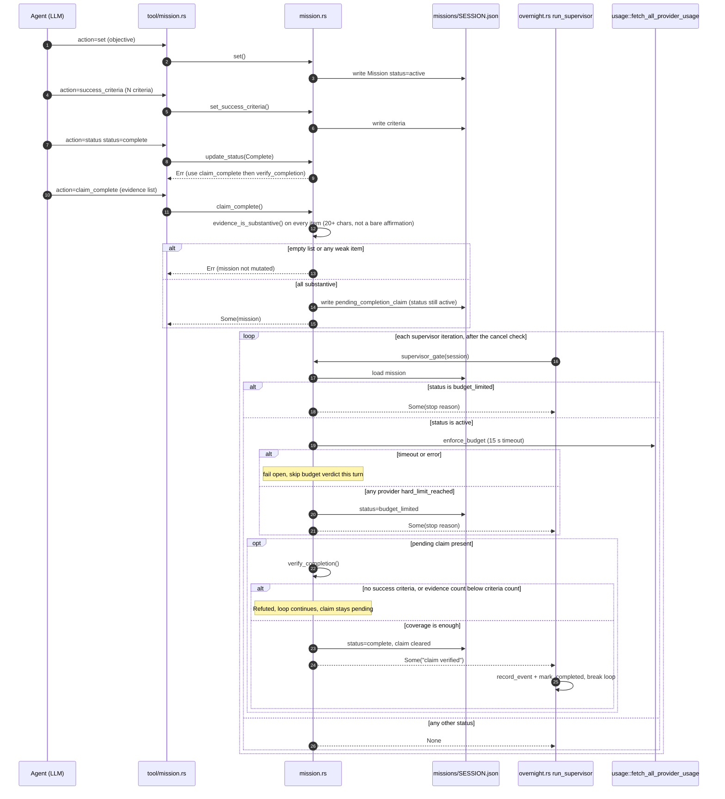
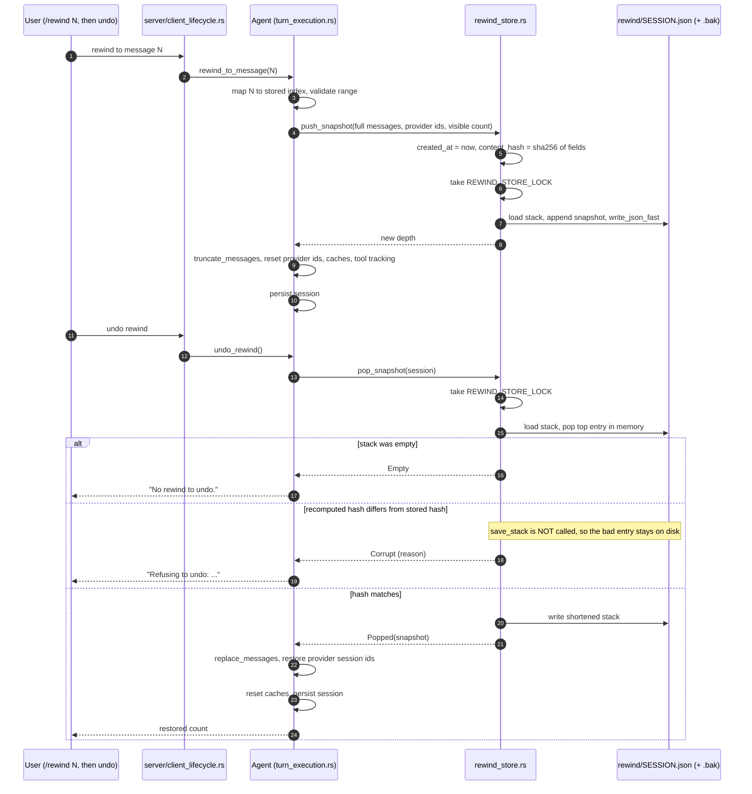
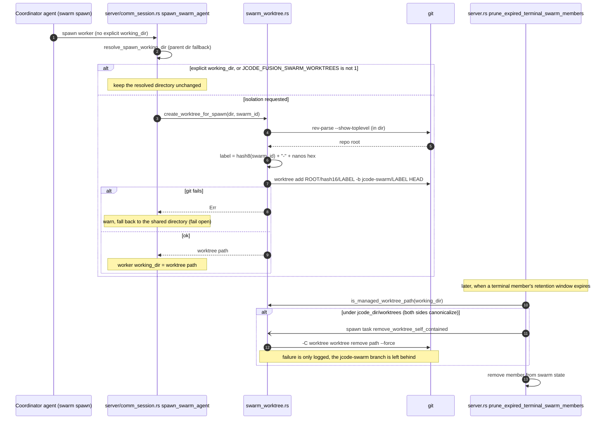
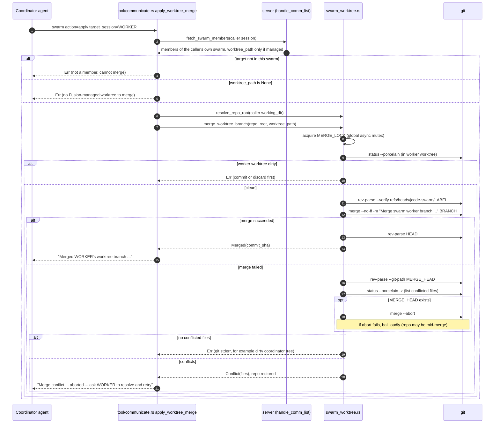
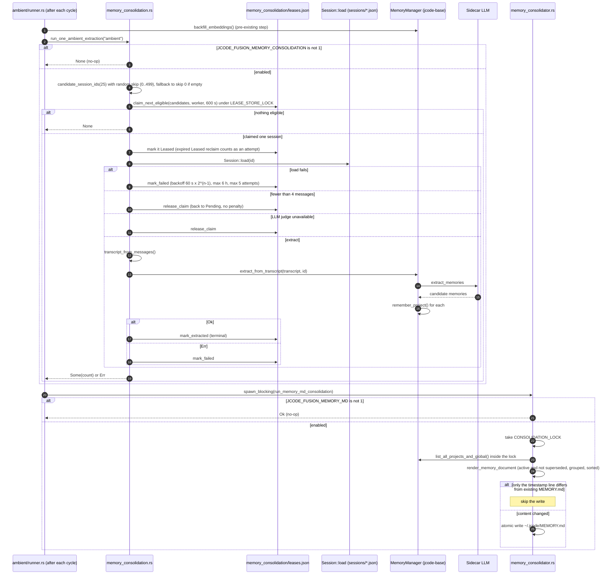

<div align="center">

# jcode-fusion

**A Rust terminal coding agent with multi-provider OAuth login, forked from [`jcode`](https://github.com/1jehuang/jcode) and extended with orchestration, safety, swarm, and memory features ported from OpenAI's [Codex Harness](https://github.com/openai/codex) and xAI's [Grok Build](https://github.com/xai-org/grok-build).**

[](LICENSE)
[](Cargo.toml)
[](#roadmap)

[Overview](#overview) · [Features](#features) · [Architecture](#architecture) · [Install](#install-and-setup) · [Usage](#usage) · [Configuration](#configuration) · [Project structure](#project-structure) · [Tests](#tests) · [Roadmap](#roadmap) · [**Deep reference**](#deep-reference-architecture-internals-and-interview-prep) · [Contributing](#contributing) · [License](#license)

</div>

---

## Overview

jcode-fusion is a fork of [jcode](https://github.com/1jehuang/jcode) v0.81.2. The base was chosen for its multi-provider login: `jcode login` authenticates against many providers through OAuth and supports several accounts per provider (`--account`), so you can use existing subscriptions without separate API billing. This fork leaves that base intact and adds nine features, each reimplemented in jcode's style rather than copied from the donor projects.

The fork is paused. The code builds once a missing asset is added (see [Build from source](#build-from-source)), and it has unit tests. Several features are opt-in, have documented limitations, or have not been exercised against a live daemon or a real provider. The [Features](#features) table says which is which. Design rationale is in [`DESIGN.md`](DESIGN.md); the phase-by-phase build log is in [`PROGRESS.md`](PROGRESS.md).

## Features

Each row says whether the feature is on by default and what it does *not* cover. Items marked **opt-in** only activate when you set the listed environment variable or file.

| Feature | Ported from | Default | What it does | Limits |
|---|---|---|---|---|
| **Mission engine** (`mission` tool) | Codex Harness, Grok Build | On | Tracks a mission's status, checkpoints, and success criteria, and marks it `budget_limited` when any connected provider reports a hard usage limit (there is no per-mission token or wall-clock accounting). An agent can *claim* completion, but the claim only succeeds after `verify_completion` checks the recorded evidence against the success criteria. | The verifier is a structural check (does the evidence cover the criteria?), not an independent LLM review. The same session can call it. |
| **Rewind** (`/rewind`) | Grok Build | On | Keeps a persisted, multi-level rewind stack. Each snapshot is verified against its SHA-256 hash before it is restored; a corrupt snapshot is refused rather than applied. | Covers conversation state only. File writes made by tools are not reverted. |
| **Guardian** | Codex Harness | On for ambient-mode permission requests | A keyword-based judge for permission requests raised in ambient mode. It can deny a request outright or defer it to the human queue. | Deny-only: it never auto-approves. Interactive tool calls do not pass through it. |
| **macOS sandbox** | Codex Harness | **Opt-in**: `JCODE_FUSION_SANDBOX=1` | Re-executes the whole binary under `sandbox-exec`, so in-process file tools and subprocesses are both covered. Writes to credential paths (`~/.ssh`, `~/.aws`, `~/.gnupg`, `~/.kube`, `~/.docker`, `~/.netrc`, and others) are denied. | macOS only. Allow-by-default with a deny list, not an allow-list. Fails open if the sandbox cannot be applied. |
| **Execpolicy** | Codex Harness | **Opt-in**: `~/.jcode/execpolicy.star` | Lets you add `confirm` or `deny` rules for bash command prefixes, on top of jcode's built-in risk classifier. | Rules can only tighten a verdict. There is no `allow` decision, and the rule format is a plain `"prefix\|decision\|reason"` list rather than a full Starlark API. |
| **Worktree-per-subagent** | Codex Harness, Grok Build | **Opt-in**: `JCODE_FUSION_SWARM_WORKTREES=1` | Each spawned swarm agent gets its own git worktree. The `apply` action merges a worker's commits back into the coordinator's tree with `git merge`. | No automated conflict resolution yet. |
| **Full ACP** (`acp` subcommand) | Grok Build | On | Runs an Agent Client Protocol adapter backed by the jcode daemon. Session lifecycle, session-scoped MCP servers, and client callbacks are implemented. With an ACP client connected, file reads and writes can go through the editor's buffer. | The file-routing wire format has not been checked against a real ACP host. |
| **Workflow tool** (`workflow`) | Grok Build | On | Saves, lists, and runs reusable, parameterized multi-agent task graphs (`save`, `list`, `run`). | `run` seeds the graph through the daemon. That round trip has not yet been exercised against a live daemon. Templates have no scripting layer and no versioning. |
| **Two-phase memory consolidation** | Codex Harness | **Opt-in**: `JCODE_FUSION_MEMORY_CONSOLIDATION=1` (ambient extraction); `JCODE_FUSION_MEMORY_MD=1` (global `MEMORY.md`) | Leased extraction jobs per session with retry backoff, then a locked-write consolidator that renders a global `MEMORY.md`. | Global `MEMORY.md` only, not per project, and no git-commit step. The interactive-exit extraction path predates the fork and runs without the variable, so the two triggers can extract the same session twice. |

The full rationale for each feature, including what was rejected and why, is in [`DESIGN.md`](DESIGN.md) §6.

## Architecture

The workspace is a layered set of Rust crates. The binary sits on top of the TUI, which sits on the application core, which sits on the base crate (auth, config, and provider core). Provider runtimes are separate crates that the binary registers at startup, so editing one does not rebuild the base → app-core → TUI stack.



Fork-specific code lives mainly in `crates/jcode-app-core/src/`:

| Module | Feature |
|---|---|
| `mission.rs`, `tool/mission.rs` | Mission engine |
| `rewind_store.rs` | Rewind stack |
| `guardian.rs` | Guardian |
| `sandbox_macos.rs` | macOS sandbox |
| `execpolicy.rs`, `tool/bash_destructive_gate.rs` | Execpolicy |
| `swarm_worktree.rs` | Worktree isolation |
| `workflow_template.rs`, `tool/workflow.rs` | Workflow tool |
| `memory_consolidation.rs`, `memory_consolidator.rs` | Memory consolidation |

Runtime state lives in a long-lived background daemon (`jcode-fusion server start`, managed with `server stop` and `server reload`). The TUI and ACP clients connect to it over a Unix socket. See [`docs/SERVER_ARCHITECTURE.md`](docs/SERVER_ARCHITECTURE.md) and [`docs/SWARM_ARCHITECTURE.md`](docs/SWARM_ARCHITECTURE.md).

## Install and setup

### Prerequisites

- A Rust toolchain with edition 2024 support (Rust 1.85 or newer), installed with [rustup](https://rustup.rs).
- A C compiler. Some dependencies, such as `aws-lc-sys`, build C code.
- Git.

This fork has been built and run on macOS. The macOS sandbox is macOS-only, and the other platform paths are not verified here.

### Build from source

```bash
git clone https://github.com/tirthfx/jcode-fusion.git
cd jcode-fusion
cargo build --bin jcode-fusion
./target/debug/jcode-fusion --help
```

> **Known build issue on macOS.** `crates/jcode-setup-hints/src/macos_launcher.rs` embeds `assets/app-icons/Jcode.icns` with `include_bytes!`, but no `assets/` directory is committed to this repository, so `cargo build` stops with `couldn't read .../assets/app-icons/Jcode.icns`. Until the file is added, copy it from [upstream jcode](https://github.com/1jehuang/jcode/blob/master/assets/app-icons/Jcode.icns) to that path before building.

The first build compiles several hundred crates, including the AWS SDK for Bedrock and the local embedding stack, and takes a long time. The default features are `pdf`, `embeddings`, and `bedrock`.

> **Do not use `scripts/install.sh` or `scripts/install.ps1` from this repo to install jcode-fusion.** Those scripts download release binaries of upstream jcode from `1jehuang/jcode`, not this fork.

### Log in to a provider

jcode-fusion has no API keys of its own. Log in to the providers you already have access to:

```bash
./target/debug/jcode-fusion login
./target/debug/jcode-fusion login claude
./target/debug/jcode-fusion auth status
```

The `--provider` choices come from [`src/cli/provider_init.rs`](src/cli/provider_init.rs). They include Claude, OpenAI, Gemini, Antigravity, OpenRouter, AWS Bedrock, GitHub Copilot, Ollama, LM Studio, and any OpenAI-compatible endpoint. Use `--account <label>` to store several accounts for one provider.

## Usage

Run a one-shot prompt. This needs a logged-in provider. Without one, the command exits with `No credentials configured for provider auto-detection`:

```bash
./target/debug/jcode-fusion run "Find the function that parses config.toml and explain its error handling"
```

With no subcommand, `jcode-fusion` starts the interactive TUI. List every subcommand with `--help`:

```bash
./target/debug/jcode-fusion
./target/debug/jcode-fusion --help
```

Run as an Agent Client Protocol adapter for an editor:

```bash
./target/debug/jcode-fusion acp
```

### Turn on the opt-in features

```bash
# macOS only: run the whole process under sandbox-exec
JCODE_FUSION_SANDBOX=1 ./target/debug/jcode-fusion

# Give each swarm agent its own git worktree
JCODE_FUSION_SWARM_WORKTREES=1 ./target/debug/jcode-fusion

# Enable background memory consolidation and the global MEMORY.md
JCODE_FUSION_MEMORY_CONSOLIDATION=1 JCODE_FUSION_MEMORY_MD=1 ./target/debug/jcode-fusion
```

### Add execpolicy rules

Create `~/.jcode/execpolicy.star` (or `$JCODE_HOME/execpolicy.star`). It must define a top-level `RULES` list. Each entry is `"prefix|decision|reason"`, where `decision` is `confirm` or `deny`:

```python
RULES = [
    "curl|confirm|network fetch, may pipe to shell",
    "wget |deny| never allowed by policy",
]
```

Rules can only make a command more restricted than jcode's built-in classifier, never less.

## Configuration

Settings are read from `~/.jcode/config.toml`, or from `$JCODE_HOME/config.toml` if `JCODE_HOME` is set. If the file is missing, built-in defaults apply. The main top-level tables are:

| Table | Controls |
|---|---|
| `[provider]` | Provider defaults, including `stream_idle_timeout_secs` (default `180`) |
| `[providers.<name>]` | Named provider profiles |
| `[auth]`, `[agents]`, `[tools]`, `[websearch]` | Authentication, agent behavior, tool settings, web search |
| `[hooks]` | Lifecycle hook commands, documented in [`docs/HOOKS.md`](docs/HOOKS.md) |
| `[ambient]`, `[safety]`, `[notifications]` | Ambient mode, permission handling, push and email notifications |
| `[compaction]`, `[power]`, `[acp]`, `[gateway]` | Context compaction, power behavior, ACP and gateway settings |
| `[keybindings]`, `[display]`, `[terminal]` | TUI keys, display, and terminal behavior |

The authoritative field list is `crates/jcode-config-types/src/lib.rs`. The system prompt can be extended without rebuilding; see [`docs/SYSTEM_PROMPT_CONFIG.md`](docs/SYSTEM_PROMPT_CONFIG.md).

### Environment variables

| Variable | Effect |
|---|---|
| `JCODE_HOME` | Overrides the state directory (default `~/.jcode`) |
| `JCODE_FUSION_SANDBOX=1` | Enables the macOS sandbox |
| `JCODE_FUSION_SWARM_WORKTREES=1` | Enables per-agent git worktrees |
| `JCODE_FUSION_MEMORY_CONSOLIDATION=1` | Enables background memory consolidation |
| `JCODE_FUSION_MEMORY_MD=1` | Enables rendering of the global `MEMORY.md` |
| `JCODE_NO_TELEMETRY=1` or `DO_NOT_TRACK=1` | Disables anonymous usage telemetry |

### Telemetry

Anonymous usage telemetry is **on by default**. The telemetry code comes from upstream jcode, and it posts to a hard-coded endpoint, `https://telemetry.jcode.sh/v1/event`, which is upstream jcode's domain. This fork has not changed that endpoint, so events go there unless you opt out. Ordinary events do not contain prompts, code, or responses. To turn telemetry off, use any of these:

```bash
export JCODE_NO_TELEMETRY=1
# or
jcode-fusion telemetry disable
```

Full transcript sharing is a separate program. It is off unless you enable it, and it is described in [`TELEMETRY.md`](TELEMETRY.md).

## Project structure

```text
.
├── src/                  # binary entry point (main.rs) and CLI (src/cli/)
├── crates/               # 82 workspace crates: core, base, app-core, tui, providers, types
├── tests/                # Rust integration tests and Python socket-based test scripts
├── scripts/              # build, install, benchmark, and guardrail scripts
├── docs/                 # architecture and feature docs
├── changelog/            # per-version changelog JSON
├── sdk/                  # TypeScript SDK for the harness API
├── ios/                  # iOS app project
├── telemetry-worker/     # Cloudflare Worker for telemetry, with D1 SQL files
├── claude-code-build/    # build-session notes for the fork
├── DESIGN.md             # design rationale for every fork feature
└── PROGRESS.md           # phase-by-phase build log
```

## Tests

Unit tests run per crate. The project has about 7,700 `#[test]` functions (counted with `grep`).

```bash
# Unit tests for the application core, where most fork features live
cargo test -p jcode-app-core --lib

# A narrower run, for example just the mission engine
cargo test -p jcode-app-core --lib mission
```

Local quality gates, run before pushing:

```bash
scripts/check_guardrails.sh --skip-slow   # format, module, warning, size, and dependency checks; skips cargo check, clippy, and machete
scripts/check_guardrails.sh               # the same, plus cargo check, clippy -D warnings, and cargo machete if installed
```

`check_guardrails.sh` mirrors a CI workflow (`.github/workflows/ci.yml`) that is **not included in this fork**, so the gates run only when invoked locally.

**Linux status (verified on Linux x86-64, Rust 1.97):** at `d91f330` the workspace did not compile on non-macOS targets (`E0425`, `SANDBOX_EXEC_PATH` used by an ungated function in `sandbox_macos.rs`); the first commit on this branch gates that function to macOS. After that, `cargo build --release --bin jcode-fusion` passes, and `cargo test -p jcode-app-core --lib` gives 1307 passed, 30 failed, 6 ignored, with all ten fork modules green and none of the 30 failures in fork code. The full `scripts/check_guardrails.sh` run exits non-zero with 8 of 13 gates failing. Details, and what could not be verified, are in [§7 of the deep reference](#7-build-test-and-what-was-verified).

**Earlier state (macOS, `--skip-slow`):** on `main` at `d91f330`, the script exits non-zero. These gates fail: `cargo fmt --all --check`, the warning budget, the oversized-file and oversized-test ratchets, the panic-prone usage ratchet, and the swallowed-error ratchet. The ratchets report growth against checked-in budget files in `scripts/`, and the failure messages say to update them only after an intentional cleanup.

The Python scripts in `tests/` (`test_injection_fix.py`, `test_injection_thorough.py`, `test_selfdev_reload.py`) connect to a running jcode server through its debug socket (`jcode-debug.sock` in the runtime directory). Start a server first, then run them with `python3`.

## Roadmap

There is no published roadmap. The following items come from the project's own notes, in [`PROGRESS.md`](PROGRESS.md) and the code comments:

- **Mission verifier**: add an independent semantic check, run by a separate agent, so the session that claimed completion cannot approve it.
- **Guardian**: add the auto-approve half, which needs a semantic judge rather than keyword matching. Replace the keyword layer with a real tokenizer.
- **Sandbox**: move from the macOS deny list to an allow-list profile, and add Linux and Windows support.
- **Execpolicy**: add a resubmit-with-justification flow for user rules.
- **Swarm**: add automated conflict resolution for merge-back, and prune worktrees that were deleted outside jcode.
- **Rewind**: add an HMAC integrity check, which needs a key-management story, for example the OS keychain. Extend rewind to file writes.
- **Memory**: make `MEMORY.md` per project, and coordinate the interactive-exit and ambient extraction triggers so they do not repeat work.
- **Verification**: exercise the workflow `run` path and the ACP file routing against a live daemon and a real ACP host.
- **Providers**: the Antigravity provider returns HTTP 429 for this fork's requests while the same account works in Google's own `agy` CLI. The cause is unresolved, and [`claude-code-build/PROJECT_FINAL_SUMMARY.md`](claude-code-build/PROJECT_FINAL_SUMMARY.md) has the full investigation.

---

# Deep reference: architecture, internals, and interview prep

This part of the README is written as an interview-ready reference. Every behavioral claim below was checked against the source in this repository (file and function names are given so you can re-check). Where the project's own prose docs (`DESIGN.md`, `PROGRESS.md`, or stale module headers) disagree with the code, **the code wins**, and the disagreement is called out in [Known doc/code drift](#66-known-doccode-drift).

## Contents

1. [What this is (the 60-second pitch)](#1-what-this-is-the-60-second-pitch)
2. [What shipped](#2-what-shipped)
3. [Architecture](#3-architecture)
4. [Module walkthroughs](#4-module-walkthroughs)
   - [4.1 `mission.rs` + `tool/mission.rs` (Mission Engine)](#41-missionrs--toolmissionrs-mission-engine)
   - [4.2 `rewind_store.rs` (provable-safe rewind)](#42-rewind_storers-provable-safe-rewind)
   - [4.3 `guardian.rs`](#43-guardianrs)
   - [4.4 `sandbox_macos.rs`](#44-sandbox_macosrs)
   - [4.5 `execpolicy.rs`](#45-execpolicyrs)
   - [4.6 `swarm_worktree.rs`](#46-swarm_worktreers)
   - [4.7 `workflow_template.rs`](#47-workflow_templaters)
   - [4.8 `tool/workflow.rs`](#48-toolworkflowrs)
   - [4.9 `memory_consolidation.rs` (phase 1)](#49-memory_consolidationrs-phase-1)
   - [4.10 `memory_consolidator.rs` (phase 2)](#410-memory_consolidatorrs-phase-2)
   - [4.11 ACP work (summary only)](#411-acp-work-summary-only)
5. [Sequence diagrams](#5-sequence-diagrams)
6. [Design rationale](#6-design-rationale)
7. [Build, test, and what was verified](#7-build-test-and-what-was-verified)
8. [Glossary](#8-glossary)
9. [Interview questions and answers](#9-interview-questions-and-answers)
10. [Build history and status](#10-build-history-and-status)

---

## 1. What this is (the 60-second pitch)

`jcode` was chosen as the base harness over Codex Harness and Grok Build for one reason: **multi-provider OAuth / multi-account auth**. Neither competitor has it; both are single-vendor tools tied to their own subscription or API billing. jcode's 40+ provider profiles with built-in OAuth login is what makes a "bring your own subscriptions, no API billing" harness possible, so it is kept untouched here.

On top of that base, this fork ports nine specific features from Codex Harness and Grok Build across five phases, reimplemented in idiomatic jcode-style Rust rather than copy-pasted (jcode is MIT, both donors are Apache-2.0). The base is pinned to jcode `v0.81.2`. The root binary is renamed `jcode-fusion` in `Cargo.toml` so it cannot collide with a normal jcode install.

The recurring engineering theme: **small, deterministic, fail-safe primitives, each opt-in or additive, each tested against real disk / real `git` rather than mocks, and each reviewed twice** (see [§6](#6-design-rationale)).

## 2. What shipped

Nine features across five phases. The "What the code actually does" column is the corrected description; where it differs from the headline you may have seen elsewhere, it is deliberate (see [Known doc/code drift](#66-known-doccode-drift)).

| Phase | Feature | Source | What the code actually does |
|---|---|---|---|
| **0 — Foundation** | Mission Engine | Codex Harness + Grok Build | A persisted per-session `Mission` state machine (7 statuses). Budget enforcement against real provider usage. A completion gate: `Complete` can only be reached via `claim_complete` (with evidence) then `verify_completion`; direct `status=complete` is rejected. Verification today is a **structural** check (criteria exist, evidence count covers criteria count), not an LLM review. |
| **0 — Foundation** | Provable-safe rewind | Grok Build | A persisted, multi-level undo stack for `/rewind`, with a SHA-256 integrity hash per snapshot. A snapshot that fails its hash is **refused, not applied, and not deleted**. Scope is conversation state only. |
| **1 — Safety** | Guardian | Codex Harness | A **deterministic keyword filter** (not an LLM judge) on ambient-mode permission requests. Deny-only: it can auto-deny, otherwise it defers to the existing human queue. It never approves. |
| **1 — Safety** | OS sandboxing (macOS slice) | Codex Harness | Opt-in whole-process Seatbelt: re-exec the entire binary under `/usr/bin/sandbox-exec` with `(allow default)` plus write-denies on credential and shell-startup paths. Fails **open**. |
| **1 — Safety** | Execpolicy | Codex Harness | A user-authored Starlark file (`~/.jcode/execpolicy.star`) defining `RULES = ["prefix\|decision\|reason", ...]`. Checked only after the built-in `jcode-command-risk` classifier says `Allow`; can only escalate to refusal, never relax. |
| **2 — Swarm rework** | Worktree-per-subagent | Codex + Grok Build (convergent) | Opt-in: each spawned swarm worker gets its own `git worktree` + `jcode-swarm/<label>` branch. Cleanup rides jcode's existing terminal-member pruning sweep. An explicit `swarm apply` action does a `git merge --no-ff` back, aborting on conflict. |
| **3 — Ecosystem** | ACP gaps | Grok Build | Session-scoped MCP servers on `session/new`; a two-hop client-callback relay; `ReadTool`/`WriteTool` route through the ACP host when the session is ACP-connected. (Summary only in [§4.11](#411-acp-work-summary-only).) |
| **3 — Ecosystem** | Orchestration-as-script | Grok Build | A `workflow` tool: `save` / `list` / `run` for parameterized `{{param}}` task-graph templates. `run` seeds a real task graph through `Request::CommSeedGraph`. **No scripting language is embedded yet**; templates are data plus string substitution. |
| **4 — Memory** | Two-phase consolidation | Codex Harness | Phase 1: lease/claim table with retry backoff and crash-loop protection, one session extracted per ambient cycle via the existing sidecar extractor. Phase 2: deterministic render of all memories to `~/.jcode/MEMORY.md` under a lock, skipping the write if only the timestamp changed. Both halves are opt-in via separate env vars. |

Item **#0** (multi-provider OAuth) is jcode's existing feature and is never modified.

**Quality process.** Two full-repo AI code scans surfaced 54 findings (13 high, 22 medium, 19 low), each triaged: fixed, confirmed pre-existing upstream, or deliberately deferred with the reason written down. A later whole-subsystem pass found three more high-severity cross-slice bugs. The recurring lesson recorded in `PROGRESS.md`: **review the fix, not just the original bug**; several "fixed" items had a second, subtler bug inside the fix, caught only by re-reviewing the diff.

## 3. Architecture

### 3.1 Where the fork code lives

All ten walkthrough modules live in one crate, `crates/jcode-app-core/src/`. This is the large "agent + server + tools" crate; Fusion deliberately did **not** add new crates (see [Q&A](#9-interview-questions-and-answers)).

```
crates/jcode-app-core/src/
├── mission.rs                  # Mission state machine, budget, completion gate, supervisor_gate
├── tool/mission.rs             # `mission` agent tool (9 actions)
├── rewind_store.rs             # persisted multi-level undo stack with SHA-256 check
├── guardian.rs                 # keyword deny filter for ambient permission requests
├── sandbox_macos.rs            # Seatbelt profile builder + re-exec under sandbox-exec
├── execpolicy.rs               # Starlark-defined user rules (prefix|decision|reason)
├── tool/bash_destructive_gate.rs   # call site that layers execpolicy on jcode-command-risk
├── swarm_worktree.rs           # git worktree create / remove / merge-back primitives
├── workflow_template.rs        # WorkflowTemplate, validate, instantiate, save/load/list
├── tool/workflow.rs            # `workflow` agent tool: save | list | run
├── memory_consolidation.rs     # phase 1: leases, candidate listing, extraction driver
└── memory_consolidator.rs      # phase 2: render + locked write of MEMORY.md
```

Touch points outside those files (all small, all additive):

| Fork module | Where it is wired in |
|---|---|
| `mission::active_system_reminder` | `crates/jcode-tui/src/tui/app/input.rs` (`mission_turn_reminder`, used at three call sites) |
| `mission::supervisor_gate` | `overnight.rs::run_supervisor`, once per loop iteration right after the cancel check |
| `rewind_store` | `agent/turn_execution.rs`: `rewind_to_message` (push), `undo_rewind` (pop), `clear` (cleanup); invoked from `server/client_lifecycle.rs` |
| `guardian::adjudicate` | `tool/ambient.rs::RequestPermissionTool::execute`, just before `system.request_permission(request)` |
| `sandbox_macos::maybe_reexec_under_sandbox` | `src/main.rs`, after the three early-return multicall entry points and before the Tokio runtime is built |
| `execpolicy` | `tool/bash_destructive_gate.rs::destructive_command_refusal` |
| `swarm_worktree::create_worktree_for_spawn` | `server/comm_session.rs::spawn_swarm_agent` |
| `swarm_worktree::remove_worktree_self_contained` | `server.rs::prune_expired_terminal_swarm_members` (fire-and-forget `tokio::spawn`) |
| `swarm_worktree::merge_worktree_branch` | `tool/communicate.rs::apply_worktree_merge`, reached by the `apply` action of the `swarm` tool |
| `AgentInfo.worktree_path` | `jcode-protocol`; filled in `server/client_comm_context.rs` only when the path passes `is_managed_worktree_path` |
| `workflow` tool | registered in `tool/mod.rs` next to `mission` |
| memory phase 1 + 2 | `ambient/runner.rs`, in the spawned block that already runs embedding backfill |

### 3.2 Cross-cutting conventions

**Opt-in switches.** Features that change behavior in a risky way are off unless an env var is exactly `"1"`:

| Env var | Gates | Checked by |
|---|---|---|
| `JCODE_FUSION_SANDBOX=1` | whole-process macOS sandbox | `sandbox_macos::is_sandboxing_requested` |
| `JCODE_FUSION_SWARM_WORKTREES=1` | worktree-per-worker on spawn | `swarm_worktree::is_worktree_isolation_requested` |
| `JCODE_FUSION_MEMORY_CONSOLIDATION=1` | phase-1 ambient extraction | `memory_consolidation::is_ambient_wiring_enabled` |
| `JCODE_FUSION_MEMORY_MD=1` | phase-2 `MEMORY.md` render | `memory_consolidator::is_memory_md_wiring_enabled` |

Not env-gated: the `mission` and `workflow` tools (registered in the base tool set in `tool/mod.rs`, inert until called), Guardian (always runs on ambient permission requests), rewind (always uses the new store), and execpolicy (inert unless `~/.jcode/execpolicy.star` exists).

**Fail-open vs. fail-closed.** The fork picks per component, and says so in code comments:

| Component | On internal error | Why |
|---|---|---|
| Sandbox setup | **open** (log, run unsandboxed) | a wrong profile that bricks startup is worse than none; opt-in anyway |
| Execpolicy load | **open** (log, treat as no user rules) | a broken policy file must not block `bash` entirely |
| `supervisor_gate` / `enforce_budget` | **open** (skip this turn's check) | a flaky usage endpoint must not stall an overnight run |
| Worktree create | **open** (fall back to shared dir) | spawn must still work |
| Rewind snapshot integrity | **closed** (refuse to restore) | applying corrupt conversation state is the failure to avoid |
| Merge-back | **closed** (refuse dirty worktree; abort conflicted merge; bail loudly if abort fails) | never hand back a half-merged repo |
| Mission completion | **closed** (no self-certified `Complete`) | the entire point of the feature |
| Guardian | n/a: a pure function with no failure path; "no verdict" means "ask the human" | |

**On-disk state.** Everything is under `crate::storage::jcode_dir()`, which is `$JCODE_HOME` if set, else `~/.jcode`. Tests point `JCODE_HOME` at a tempdir.

| Path | Owner | Format |
|---|---|---|
| `missions/<session>.json` | `mission.rs` | one `Mission` JSON |
| `rewind/<session>.json` (+ `.bak`) | `rewind_store.rs` | `{ "snapshots": [RewindSnapshot, ...] }` |
| `execpolicy.star` | `execpolicy.rs` | Starlark source, user-written |
| `worktrees/<16-hex>/<label>/` | `swarm_worktree.rs` | a git worktree checkout |
| `workflows/<name>.json` | `workflow_template.rs` | one `WorkflowTemplate` JSON |
| `memory_consolidation/leases.json` | `memory_consolidation.rs` | `{ "leases": { session_id: SessionLease } }` |
| `MEMORY.md` | `memory_consolidator.rs` | rendered markdown |

Session ids and template names are sanitized into filenames by replacing anything outside `[A-Za-z0-9_-]` with `_` (`sanitize_session_id` in `mission.rs` / `rewind_store.rs`, `sanitize_name` in `workflow_template.rs`).

**Persistence primitive.** All JSON goes through `jcode-storage`'s `write_json_fast` / `read_json`: write to a temp file, then atomic `rename` (no fsync in the "fast" variant); on Unix, the previous version is first hard-linked to `<file>.bak`. `read_json` falls back to the `.bak` if the primary fails to parse. Consequence worth knowing: a *syntactically corrupt* file is silently healed from `.bak`; a *syntactically valid but altered* file is not detected by storage, which is why `rewind_store` adds its own content hash.

**Concurrency model.** Every fork module that does load-mutate-save uses a **process-wide** mutex (`MISSION_LOCK`, `REWIND_STORE_LOCK`, `LEASE_STORE_LOCK`, `CONSOLIDATION_LOCK` as `std::sync::Mutex`, and `MERGE_LOCK` as a `tokio::sync::Mutex`), not a per-session map. Reasoning in the code: these are not hot paths, and all background work runs as `tokio::spawn` tasks inside the single daemon process, so an in-process lock is sufficient. The documented caveat: a separate CLI process doing the same work would **not** be covered.

**Testing convention.** Tests touch real disk (tempdirs with `JCODE_HOME` redirected under `crate::storage::lock_test_env()`) and real `git` (`git init` + commits in tempdirs). The `workflow` tool's `run` fast-fail paths are tested with no daemon running.

---

## 4. Module walkthroughs

Each section: purpose, key types and functions, on-disk data, step-by-step flow, failure modes, tests. Test counts are the number of `#[test]` / `#[tokio::test]` functions in the file, and the exact pass/fail run is in [§7](#7-build-test-and-what-was-verified).

### 4.1 `mission.rs` + `tool/mission.rs` (Mission Engine)

**Purpose.** Give a session a durable "mission" with a real state machine, real budget accounting, and a completion rule an agent cannot self-certify. It finishes an orphaned jcode module (`Mission`/`MissionStatus` existed, but `mission::set()` had zero callers). It was renamed from "Goal Engine" because jcode already ships an unrelated `Goal` / `initiative` tool.

**Key types.**
- `MissionStatus`: `Active`, `Paused`, `Blocked`, `NeedsDecision`, `BudgetLimited`, `Complete`, `Abandoned` (serde `snake_case`; `parse` accepts `needs-decision` / `completed` aliases).
- `Mission { session_id, objective, long_horizon_intent, status, semantic_expansion, success_criteria, validation_plan, checkpoints, pending_completion_claim, created_at, updated_at }`.
- `CompletionClaim { evidence: Vec<String>, claimed_at }`; `MissionCheckpoint { at, summary }`.
- `VerificationOutcome`: `NoPendingClaim`, `Refuted { reason }`, `Confirmed { mission }`.

**Key functions.**

| Function | Behavior |
|---|---|
| `set(session, objective)` | Trims; empty objective is an error. Creates the mission or **reuses an existing one** (keeping criteria, checkpoints, and any pending claim), overwrites objective and intent, and forces `status = Active`. |
| `set_success_criteria(session, Vec<String>)` | Trims, drops empty strings, replaces the list. Returns `Ok(None)` if no mission. |
| `update_status(session, status)` | **Rejects `Complete` outright** with an error telling you to use claim then verify. Anything else is persisted. |
| `claim_complete(session, evidence)` | Requires non-empty evidence; each item must satisfy `evidence_is_substantive` (≥ `MIN_EVIDENCE_LEN` = 20 chars after trim, and not in a bare-affirmation list). Stores a `CompletionClaim` **without changing `status`**. |
| `verify_completion(session)` | `NoPendingClaim` if none. `Refuted` if there are no success criteria, or `evidence.len() < success_criteria.len()`. Otherwise sets `Complete` and clears the claim. |
| `enforce_budget(session)` | If `Active`: calls `crate::usage::fetch_all_provider_usage()` under a **15 s timeout**; if any `ProviderUsage.hard_limit_reached`, sets `BudgetLimited`. On timeout: logs a warning and **skips** this check. |
| `supervisor_gate(session)` | Returns `Ok(Some(stop_reason))` to stop a loop, else `Ok(None)`. See flow below. |
| `checkpoint(session, summary)` | Appends; **caps the list at `MAX_CHECKPOINTS` = 200**, dropping oldest. |
| `active_system_reminder(session)` | If the mission is `Active`, renders `MISSION_CONTINUATION_TEMPLATE` (from `jcode-base/src/prompt/mission_continuation.md`) with the objective and intent XML-escaped (`& < >`). |
| `clear(session)` | Deletes the file (takes no lock; does not remove a `.bak`). |

**The tool.** `tool/mission.rs` exposes one `mission` tool with actions `set`, `show`, `status`, `checkpoint`, `check_budget`, `success_criteria`, `claim_complete`, `verify_completion`, `clear`. The tool's `status` enum deliberately **omits `complete`**. Tool descriptions are kept terse because jcode has token-cap tests for tool and parameter descriptions (the slice-1 mission tool initially violated them).

**On-disk data.** `<jcode_dir>/missions/<sanitized session id>.json`. Written via `write_json_fast`. Optional vec fields are `skip_serializing_if` empty.

**Flow (happy path).**
1. Agent calls `mission set` with an objective. A `Mission` is written, `status=Active`. From now on the TUI injects the continuation reminder into turns while `Active`.
2. Agent calls `mission success_criteria` with N criteria.
3. Agent works, optionally calling `mission checkpoint`.
4. Agent calls `mission claim_complete` with ≥ N substantive evidence strings. Status is unchanged; the claim is pending.
5. Someone calls `verify_completion`: either the agent itself via the tool, or the Overnight supervisor via `supervisor_gate` on its next loop iteration. If the counts line up, status flips to `Complete`.

**`supervisor_gate` flow.** (1) No mission: `None`. (2) Status `BudgetLimited`: stop. (3) Status not `Active`: `None` (not this function's job). (4) Run `enforce_budget`; if it transitions to `BudgetLimited`, stop; if it errors, log and continue (fail open, but still go on to step 5). (5) If the mission snapshot has a pending claim, run `verify_completion`: `Confirmed` stops the loop; `Refuted` logs and **does not** stop; the mission stays `Active` with the claim still pending. The caller, `overnight.rs::run_supervisor`, records a `mission_supervisor_gate_stop` event and calls `mark_completed(.., Completed, reason)`, or on an `Err` from the gate logs and carries on.

**Failure modes.**
- Weak/empty evidence: `claim_complete` errors and the mission is not mutated (tested).
- Verification is **structural only**: N evidence strings of 20+ arbitrary characters pass for N criteria. The code's own doc says so; a real "try to refute this" sub-agent is the stated next step.
- The same session that filed the claim can also call `verify_completion` (no identity separation yet; documented).
- Budget check is provider-agnostic: *any* connected provider being hard-limited trips it, not specifically the session's provider (documented simplification).
- `clear` bypasses `MISSION_LOCK`.
- Hung usage endpoint: bounded by the 15 s timeout, fails open.

**Tests.** `mission.rs` has 20 unit tests in four test modules: `completion_verification_tests` (bare affirmations rejected, short strings rejected, real evidence accepted, weak claim does not mutate, `update_status` cannot reach `Complete`, verify refutes without criteria, refutes on insufficient coverage, confirms when the bar is met, no pending claim), `checkpoint_and_concurrency_tests` (cap drops oldest, 20 concurrent checkpoints lose none), `supervisor_gate_tests` (no mission continues, active with no claim continues, already `BudgetLimited` stops immediately, non-active passes through, confirmed claim stops and persists `Complete`, refuted claim does not stop and stays pending), and `budget_tests` (pure `any_provider_hard_limited`: none / all under / one tripped). `tool/mission_tests.rs` has `mission_tool_full_round_trip`; `examples/mission_tool_demo.rs` drives the real tool end to end. **Gap:** the real `fetch_all_provider_usage()` path is not covered by an automated test (needs live credentials/network); only the pure decision function is.

### 4.2 `rewind_store.rs` (provable-safe rewind)

**Purpose.** jcode already had `/rewind`, but its undo state was one in-memory snapshot (lost on restart, overwritten by a second rewind, no integrity check). This module replaces it with a **persisted, multi-level, integrity-checked undo stack**. "Provable-safe" here means *provably not corrupted*, not *tamper-proof*: the hash is unkeyed SHA-256, so anyone with write access to the file can recompute it (stated in the `content_hash` doc comment; an HMAC would need key management).

**Key types.**
- `RewindSnapshot { messages: Vec<StoredMessage>, provider_session_id, session_provider_session_id, visible_message_count, created_at, content_hash }`.
- `RewindStack { snapshots: Vec<RewindSnapshot> }` (private, serialized form).
- `PopOutcome`: `Empty`, `Corrupt { reason }`, `Popped(Box<RewindSnapshot>)`.

**Key functions.** `push_snapshot` (returns new depth), `pop_snapshot`, `depth`, `clear`, plus private `compute_hash`, `load_stack`, `save_stack`, `stack_path`.

**Hashing.** `compute_hash` serializes `{messages, provider_session_id, session_provider_session_id, visible_message_count, created_at}` with `serde_json` and returns lowercase hex SHA-256. `created_at` is computed once by the caller and used for both the hash and the stored field (an earlier version hashed before the timestamp existed, leaving it unprotected).

**On-disk data.** `<jcode_dir>/rewind/<session>.json`, with `write_json_fast`'s `.bak` hard link beside it. Each snapshot stores the **entire message list**, so storage grows linearly with depth × transcript size.

**Flow: rewind.** `Agent::rewind_to_message(n)` validates `n` against the visible rewind targets, calls `push_snapshot` with a clone of the **full pre-truncation** messages and both provider session ids, *then* truncates the session, resets provider session ids, the cache tracker and tool-output tracking, and persists the session. Push happens first and uses `?`-style error mapping, so if persisting the snapshot fails the rewind does not proceed.

**Flow: undo.** `Agent::undo_rewind()` calls `pop_snapshot`:
1. Under `REWIND_STORE_LOCK`, load the stack and pop the top entry. Empty → `Empty` ("No rewind to undo.").
2. Recompute the hash from the entry's fields. Mismatch → return `Corrupt` **before** calling `save_stack`, so the on-disk file still contains the bad entry (refused, not discarded, so a human can inspect it).
3. Match → save the shortened stack and return `Popped`; the agent calls `replace_messages` with it and restores the provider session ids.

Repeated undos walk back through multiple prior rewinds (LIFO).

**`clear`.** Removes the stack file *and* its `.bak` (the `.bak` otherwise keeps a full copy of the "discarded" history). `Agent::clear()` calls it for the session being discarded. `restore_session_with_working_dir` and `reset_runtime_state_for_session_change` deliberately **do not**: they are used for ordinary session switching, and clearing there would destroy live undo data for a session the user may switch back to.

**Failure modes.**
- Tampered or altered snapshot → `Corrupt`, entry kept (tested for both a message edit and a `created_at`-only edit).
- Two concurrent pushes for one session → serialized by the global mutex (tested with 20 threads).
- Poisoned mutex → recovered via `PoisonError::into_inner`, so one panic cannot wedge all rewinds.
- Out of scope, documented: **filesystem / tool side effects are not reverted**. Only conversation state is.
- Note: this module has **no compaction logic** at all; it snapshots the full stored message list. `PROGRESS.md` records that jcode's compaction only tracks a `compacted_count` cursor (the field exists in `jcode-session-types`) rather than destroying raw messages, which is why a full-message snapshot stays valid; that compaction claim was taken from the project docs, not re-audited here. The earlier headline "refuses to guess after compaction" is therefore really about the integrity check, not a compaction-specific reconstruction path.

**Tests (7):** `empty_stack_reports_empty`, `push_then_pop_round_trips`, `multi_level_stack_pops_in_lifo_order`, `tampered_snapshot_is_refused_not_applied` (also asserts depth stays 1), `tampering_with_created_at_alone_is_also_caught`, `concurrent_pushes_for_the_same_session_never_lose_a_snapshot`, `clear_removes_the_whole_stack`. **Gap:** there is no test that drives `Agent::rewind_to_message` / `undo_rewind` themselves; the module's tests exercise the store.

### 4.3 `guardian.rs`

**Purpose.** An automatic backstop on **ambient-mode** permission requests. jcode has no general interactive "approve this command?" prompt, only `SafetySystem::request_permission` for ambient (autonomous) sessions, so that is the only place Guardian can sit.

**It is not an LLM judge.** Despite the Codex lineage, this is a pure, synchronous, deterministic keyword matcher. The module's own header explains why it never approves: a missed keyword means "no verdict", not "safe", so auto-approving on keyword *absence* would be an overclaiming signal.

**Key types.** `GuardianDecision { Deny, Undecided }`, `GuardianVerdict { decision, reason }`, `RiskCategory { DestructiveAction, CredentialProbing, DataExfiltration, PersistentSecurityWeakening }` (Codex's four categories).

**Key functions.** `adjudicate(&PermissionRequest) -> GuardianVerdict`; private `flatten_json_into`, `normalize_whitespace`, and `RiskCategory::keywords()` (curated lists, e.g. `"rm -rf"`, `"drop table"`, `"private key"`, `"exfiltrate"`, `"disable the sandbox"`, `"chmod 777"`).

**Flow.**
1. Build a haystack: `action + description + rationale`, then append the flattened `context` JSON (strings, array items, object **keys and values**, numbers, bools).
2. `normalize_whitespace` (collapse every whitespace run, including newlines, to one space), then lowercase.
3. For each category in fixed order, for each keyword: if `haystack.contains(keyword)` → `Deny` with a reason naming the category and the matched keyword.
4. Otherwise `Undecided`, "deferring to human review".

**Wiring.** In `RequestPermissionTool::execute`: if the verdict is `Deny`, the request is answered `PermissionResult::Denied { reason }` immediately and never enters the human queue; otherwise it falls through to `get_safety_system().request_permission(request)` unchanged.

**Failure modes (known, written in the code).**
- Object keys act as word separators, so `{"1": "rm", "2": "-rf"}` flattens to `" 1 rm 2 -rf"` and evades `"rm -rf"`. A real tokenizer is the fix.
- Non-ASCII homoglyph substitution is not defended against (case-folding only).
- False positives are possible by design; the deny message tells the caller to rephrase or ask the user.
- Scope: it never sees normal interactive tool calls.

**Tests (12):** benign is undecided; one deny test per category; case-insensitivity; keyword in rationale only; keyword smuggled in `context` values; keyword in a `context` object key; benign context stays undecided; keyword split across fields with a double space; keyword split by an embedded newline.

### 4.4 `sandbox_macos.rs`

**Purpose.** OS-level confinement for the **whole** jcode-fusion process on macOS, using Seatbelt (`sandbox-exec`). Whole-process (re-exec the entire binary) rather than wrapping the bash tool's subprocess, because file-edit tools like `WriteTool` write in-process with `tokio::fs::write` and would be invisible to a subprocess wrapper.

**Deliberately conservative.** The profile is `(version 1)(allow default)` plus write denies, **not** deny-by-default. A wrong deny-by-default profile can brick the app (no shared libraries, no temp files, no network for LLM calls).

**Key functions.**
- `is_sandboxing_requested()` (`JCODE_FUSION_SANDBOX == "1"`) and `is_already_sandboxed()` (`JCODE_FUSION_SANDBOXED == "1"`, the loop-prevention marker set on the re-exec'd child).
- `default_protected_write_subpaths()`: `.ssh`, `.gnupg`, `.aws`, `.config/gcloud`, `.docker`, `.kube`, `.netrc`, `.npmrc`, `.pypirc`, `.config/gh`, `.azure`, plus shell-startup/persistence paths `.zshrc`, `.zprofile`, `.bashrc`, `.bash_profile`, `Library/LaunchAgents`.
- `resolve_default_protected_paths()`: resolves those against **both** `dirs::home_dir()` (reads `$HOME`) **and** `system_home_dir()` (`getpwuid(getuid())`, independent of `$HOME`), each canonicalized.
- `resolve_protected_paths_from(home)`: canonicalize home, join each subpath, and protect **both** the literal leaf and its canonical resolution if they differ.
- `build_seatbelt_profile(&[PathBuf])`: emits `(deny file-write* (subpath "..."))` for every protected path, and, for each protected path's immediate parent, `(deny file-write-rename (literal ..))` and `(deny file-write-unlink (literal ..))`. Strings are escaped (`\` and `"`).
- `maybe_reexec_under_sandbox()`: macOS-only implementation; a documented no-op on other platforms.

**Flow (macOS).**
1. `src/main.rs` calls `maybe_reexec_under_sandbox()` after the early multicall entry points and before the Tokio runtime exists (re-exec must happen from a clean single-threaded process).
2. Not requested → return. Already carries the marker → log a warning and return (the skip is observable, though a spoofed marker would still silently disable sandboxing).
3. Build the profile; run `/usr/bin/sandbox-exec -p <profile> -- <current_exe> <args...>` with `JCODE_FUSION_SANDBOXED=1`, via `crate::platform::replace_process` (process image replaced; never returns on success). Profile is passed inline with `-p`, so there is no temp file.
4. Any error → warn and continue unsandboxed.

**Why canonicalize.** Seatbelt matches `subpath` rules against the *resolved* path. `/var/folders/...` is a symlink to `/private/var/folders/...`, so a rule written against the symlinked form silently protects nothing. This was found by a raw `sandbox-exec` experiment that "worked" but did nothing, and is covered by a symlink regression test.

**Why protect the parent.** A `subpath` rule on `~/.config/gh` does not stop renaming `~/.config` away; the literal rename/unlink denies on the parent close that.

**Failure modes.** Fails open on any setup error (design choice, documented); `$JCODE_FUSION_SANDBOXED` is a plain env var; three multicall entry points (setup-hint callback, macOS global-hotkey listener, notification broker) run before the sandbox and are intentionally unsandboxed since they never reach agent/tool code; only write denies, so reads of secrets are still allowed (many tools legitimately read e.g. `~/.gitconfig`); not exhaustive by design; Linux (bwrap/Landlock) and Windows are **not implemented**.

**Tests (13), pure and runnable on any OS because the profile/path logic is not cfg-gated:** profile with no paths is just `allow default`; denies each protected path; escapes embedded quotes; resolved paths follow symlinks (home, and the leaf itself); profile denies rename/unlink of each parent; default subpaths cover credentials and shell-startup/persistence; `system_home_dir` returns a real directory; protection still covers the system home when `$HOME` is spoofed; sandboxing off by default; requires exactly `"1"`; marker read correctly. **Not testable on Linux:** the actual `sandbox-exec` re-exec (see [§7](#7-build-test-and-what-was-verified)).

### 4.5 `execpolicy.rs`

**Purpose.** Let users add their own command rules (as a Starlark file) **on top of** jcode's existing `jcode-command-risk` blast-radius classifier, which is untouched.

**Why it lives here, not in `jcode-command-risk`.** That crate has zero dependencies by design ("not another model"); embedding a Starlark interpreter would contradict that. So `execpolicy.rs` sits in `jcode-app-core` (new dependency `starlark = "0.14"`), and the call site layers it.

**Key types.** `UserDecision { Confirm, Deny }` (derives `Ord`; **both currently refuse identically**: no resubmit-with-justification path for user rules), `UserRule { prefix, decision, reason }`, `BuiltInRestrictiveness { Allow, ConfirmOrDeny }`.

**Key functions.** `default_policy_path()` (`~/.jcode/execpolicy.star`), `load_user_rules(path)`, private `parse_policy_source` / `parse_rule_line`, `matching_rule(command, rules)`, `combine(built_in, user_match)`.

**Rule format.** The script must define a top-level `RULES` list of strings `"prefix|decision|reason"` (`splitn(3, '|')`, `decision` ∈ `confirm`/`deny`, case-insensitive; `prefix` and `reason` trimmed). The script is real Starlark, so loops, `def` and list comprehensions can generate the list; only the per-rule encoding is minimal.

**Flow at the call site** (`tool/bash_destructive_gate.rs::destructive_command_refusal`):
1. `jcode_command_risk::assess(command, ctx)`. If the level `runs_immediately()` there is no built-in refusal; otherwise `gate(...)` yields `Allow`, `Deny { reason }`, or `Reflect { prompt }`, and the latter two become `Some(refusal text)`.
2. `built_in_refusal.or_else(|| check_user_policy_only(command))`. The `.or_else` means the user policy **cannot run** on a path that already produced a built-in refusal. That invariant is enforced by the shape of the expression, not by call-site discipline.
3. `check_user_policy_only`: `user_rules()` (cached in a `OnceLock`), `matching_rule` (first match wins; the command's whitespace is collapsed first so `rm\t-rf` still matches `rm `), then `combine(Allow, matched)`, then a string `"Blocked by execpolicy rule (prefix ..): reason"`.

**Resource bounds.** Policy file capped at 1 MiB (checked by metadata before reading). Evaluation limits: `set_max_tick_count(1_000_000)` and `set_max_heap_size(16 MiB)`; an over-limit script surfaces as an `Err`, handled fail-open at the call site. Empty prefix is rejected at parse time (it would match every command).

**Caching.** `user_rules()` populates the `OnceLock` only on a **successful** load (including "no policy file"), so a transient I/O error retries on the next command rather than disabling a valid policy for the whole process. Consequence: after a successful load, editing the policy requires restarting the process.

**Failure modes.** Prefix matching is a plain `starts_with` on the whitespace-normalized command (no word-boundary check: prefix `rm` also matches `rmdir`), by design; `Confirm` ≡ `Deny`; the `OnceLock` wrapper is not integration-tested (process-global state).

**Tests (15):** size cap refusal; empty list; valid rules parse (including `"wget |deny|.."` trimming to prefix `wget`); script generates rules programmatically; missing `RULES`; malformed line; unknown decision; empty prefix rejected; syntax error reported not panicked; prefix match; whitespace-insensitive match; a user rule never overrides a built-in restriction; user rule applies only when the built-in would have allowed; a runaway loop hits the tick limit; an ordinary policy still parses.

### 4.6 `swarm_worktree.rs`

**Purpose.** Give each spawned swarm worker its own `git worktree` so concurrent workers do not edit the same files, and let the coordinator merge a worker's branch back on explicit request. Both Codex's `worktree` crate and Grok Build's subagent isolation converged on this pattern; jcode's own conflict handling was advisory (post-hoc file-touch notices, no locking). The jcode **coordinator** (`VersionedPlan`, roles, messaging) is kept; only the conflict mechanism changes.

**Key functions.**

| Function | Behavior |
|---|---|
| `is_worktree_isolation_requested()` | `JCODE_FUSION_SWARM_WORKTREES == "1"` |
| `worktree_root_for(repo_root)` | `<jcode_dir>/worktrees/<first 16 hex of SHA-256(canonical repo root)>/` |
| `generate_worker_label(swarm_id)` | `<first 8 hex of SHA-256(swarm_id)>-<hex of current nanos as u64>` |
| `resolve_repo_root(cwd)` | `git -C cwd rev-parse --show-toplevel`; builds the `PathBuf` from raw bytes on Unix (no lossy UTF-8), strips only the exact trailing `\n` |
| `create_worktree(repo, label)` | `git -C repo worktree add <root>/<label> -b jcode-swarm/<label> HEAD` |
| `create_worktree_for_spawn(dir, swarm_id)` | resolve + label + create |
| `remove_worktree(repo, path)` / `remove_worktree_self_contained(path)` | `git worktree remove <path> --force`; the self-contained form runs `git -C <worktree>` since `SwarmMember` stores only `working_dir` |
| `is_managed_worktree_path(path)` | true iff **both** `<jcode_dir>/worktrees` and `path` canonicalize and the path is under the root |
| `branch_name_for_worktree(path)` | `jcode-swarm/<dir name>` (pure inverse of `create_worktree`) |
| `worktree_is_clean(path)` | `git status --porcelain` is empty |
| `merge_worktree_branch(repo, worktree)` | see flow |

**Types.** `MergeOutcome { Merged { commit_sha }, Conflict { files } }`. There is deliberately no "merged with conflicts left in the tree" state.

**Flow: spawn** (`comm_session.rs::spawn_swarm_agent`). Isolation applies only if the caller did **not** pass an explicit `working_dir` *and* the env var is set *and* `resolve_spawn_working_dir` produced a directory. Then `create_worktree_for_spawn` runs; on success the worker's `working_dir` is the worktree path; on any error it warns and keeps the shared directory (fail open).

**Flow: cleanup** (`server.rs::prune_expired_terminal_swarm_members`). When a terminal member's retention window expires and it is pruned, if its `working_dir` passes `is_managed_worktree_path`, a fire-and-forget `tokio::spawn` calls `remove_worktree_self_contained`. Failure is logged, not fatal. The `jcode-swarm/<label>` **branch is left behind**.

**Flow: apply / merge** (`tool/communicate.rs::apply_worktree_merge`, `swarm` tool action `apply`, aliases `merge` / `merge_back` / `apply_worktree`; requires `target_session`):
1. `fetch_swarm_members(caller)` scopes to the caller's own swarm; a `target_session` outside it is rejected (ownership check).
2. `member.worktree_path` must be `Some` (set only for managed paths), else an explanatory error.
3. The caller's `ctx.working_dir` → `resolve_repo_root` → the coordinator's repo.
4. `merge_worktree_branch` acquires `MERGE_LOCK` (global async mutex), then:
   - refuses (error) if the worker's worktree is dirty;
   - derives the branch name; `git rev-parse --verify refs/heads/<branch>` must succeed;
   - `git merge --no-ff -m "Merge swarm worker branch '<branch>' (jcode-fusion merge-back)" <branch>`;
   - success → `Merged { commit_sha }` from `git rev-parse HEAD`;
   - failure → ask git where `MERGE_HEAD` is (`git rev-parse --git-path MERGE_HEAD`, correct even when the coordinator's tree is itself a linked worktree whose `.git` is a file); list conflicted paths via `git status --porcelain -z` (UU/AA/DD/AU/UA/DU/UD); if a merge was genuinely in progress, run `git merge --abort` and **bail loudly if the abort itself fails**; if there are no conflicted files (e.g. coordinator tree dirty, hook rejection) return an error carrying git's stderr rather than a false empty `Conflict`; else `Conflict { files }`.

**Failure modes and safeguards.** Dirty worker tree refused; coordinator-side dirty tree reported cleanly (no `MERGE_HEAD` ever created, so no spurious abort); race between concurrent `apply` calls closed by `MERGE_LOCK`; no shell is ever involved (`tokio::process::Command` with separate `.arg()`s), so branch names and paths cannot inject; non-UTF-8 repo paths and special-character conflict filenames are handled. **Not done:** no automatic conflict resolution; no branch deletion after merge (branches accumulate); no periodic `git worktree prune` for worktrees deleted out-of-band (the double-canonicalize requirement in `is_managed_worktree_path` was a deliberate security fix and weakening it was rejected).

**Tests (23, all against real `git` in tempdirs):** opt-in default-off; unique labels; root bucketing by canonical path; repo-root from a subdirectory; failure outside a repo; a real working checkout; two concurrent worktrees independent; `create_worktree_for_spawn` fails cleanly outside a repo; managed-path recognition and rejection; self-contained removal; removal; branch-name derivation matches a real `create_worktree`; clean/dirty detection; dirty worktree refused; clean commit merges into the coordinator; **conflict leaves the repo clean** (no `MERGE_HEAD`/unmerged state); dirty coordinator tree reported cleanly; special-character filenames; nonexistent branch fails cleanly; concurrent merges against different repos both complete; conflict detected and aborted when the coordinator tree is itself a worktree.

### 4.7 `workflow_template.rs`

**Purpose.** Orchestration-as-script's data layer: a saved, parameterized, replayable task graph. Persistence of live plans (`VersionedPlan`) already existed (`server/swarm_persistence.rs`); what was missing was *templating*.

**Key types.**
- `WorkflowTemplate { name, description, parameters: Vec<WorkflowParameter>, nodes: Vec<TemplateNode> }`
- `WorkflowParameter { name, description, default: Option<String> }` (`None` default ⇒ required)
- `TemplateNode { id, content, kind: Option<String>, priority: u8 (default 1), depends_on: Vec<String> }`, which matches `TaskGraphNodeSpec` field-for-field. It was first modeled on `PlanItem` and retargeted after reading the real `seed_graph` integration point.

**Key functions.** `validate()`, `instantiate(&HashMap<String,String>) -> Vec<TaskGraphNodeSpec>`, `save`, `load`, `list`, private `sanitize_name`, `template_path`, `is_safe_identifier_charset`, `sanitize_for_display`, `find_unresolved_placeholder`.

**`validate()` rejects:** empty or unsafe-charset template `name`; no nodes; empty / unsafe-charset / duplicate node ids; `depends_on` referencing an unknown node; empty / unsafe-charset / duplicate parameter names. The safe charset is `[A-Za-z0-9_-]`; it exists because names and ids are echoed into tool output, where a newline or ANSI escape could spoof entries. **It does not check for dependency cycles** (a search of the module finds none); `jcode-plan` has its own cycle detection (`cycle_item_ids`), but this module does not call it.

**`instantiate()` flow.** (1) `validate()`. (2) Resolve each declared parameter: supplied value, else default, else collect as missing; any missing → error listing them. (3) For each node, substitute `{{name}}` placeholders **in declared parameter order** (stable; an earlier `HashMap` iteration made double-substitution nondeterministic). (4) If any `{{...}}` remains in the result, refuse: the template referenced an undeclared parameter, which is an authoring bug, not something to bake into a real task. (5) Emit `TaskGraphNodeSpec`s.

**Persistence.** `<jcode_dir>/workflows/<name>.json` via `write_json_fast`. `save` validates before writing. `load` and `list` **re-validate** what they read, because a hand-edited file bypasses `save`; `list` silently skips files that fail to parse or validate. `load`'s "no workflow template named" error runs the raw input through `sanitize_for_display` (strips ASCII control chars) since no template exists to validate.

**Failure modes.** Placeholder substitution is plain string replace (a parameter *value* containing another `{{name}}` is handled deterministically but may be substituted again); no cycle check; no template versioning/migration; no embedded scripting (Starlark is already a dependency and is the planned route, not Rhai).

**Tests (19):** substitution with declared and default values; determinism when a value contains another placeholder; missing required parameter refused; undeclared reference refused; dangling `depends_on`; duplicate node ids; duplicate parameter names; unsafe node id; unsafe parameter name; `load` rejects a hand-edited unsafe file; `list` skips such a file; no nodes; unsafe name; real-disk save/load round trip; invalid template never persisted; unknown name fails cleanly; unknown-name error has no raw control characters; `list` returns sorted names; path-traversal-shaped names sanitized.

### 4.8 `tool/workflow.rs`

**Purpose.** The agent-facing `workflow` tool wrapping the module above. It is a **separate tool**, not another action on the already-large `swarm` schema, to avoid the tool-description token-cap pressure that the `apply` action's description had already hit.

**Schema.** `action ∈ {save, list, run}`; `name`, `description`, `parameters[]`, `nodes[]`, `values{}`, `mode ∈ {deep, light}`.

**Flow.**
- `save`: requires `name` and `nodes`; builds a `WorkflowTemplate`; `workflow_template::save` (validates); returns "Saved workflow template '..' (N node(s), M parameter(s))."
- `list`: `workflow_template::list`, formatted as a bullet list or "No saved workflow templates."
- `run`: requires `name`; `load(name)` → `template.instantiate(&values)` (both can fail **before any daemon contact**) → `Request::CommSeedGraph { id: REQUEST_ID, session_id, mode, nodes }` sent through `tool::communicate::transport::send_request` (visibility widened from `pub(super)` to `pub(crate)`; a fresh socket per request, so a constant request id is safe) → on a `ServerEvent::Error` returns that message; on success echoes the **validated** `template.name` and the seeded node ids.

**Deliberate simplification.** Unlike `swarm task_graph`, `run` does not retry-and-rename on a node-id collision; template ids are author-controlled and meant to stay stable, so the daemon's error is surfaced as-is.

**Failure modes.** `run`'s real daemon round trip has **never been exercised against a live daemon** (the tests cover the fast-fail paths and the persistence); a pre-existing regression-detector test (`only_the_known_open_world_tools_are_ineligible_for_openai_strict_mode`) had to be updated because the `values` map has no fixed properties.

**Tests (7, in `tool/workflow_tests.rs`):** save/list round trip (verified by `load()`), `save` rejects an empty `nodes` array, `save` requires name and nodes, `save` rejects an invalid template and never persists it, `run` fails cleanly for an unknown template **before touching the daemon**, `run` fails cleanly on a missing required parameter before touching the daemon, schema lists all three actions.

### 4.9 `memory_consolidation.rs` (phase 1)

**Purpose.** Retroactively extract memories from sessions that closed, crashed, or were never revisited. Before this, extraction ran only at interactive-CLI exit. It formalizes jcode's own documented-but-unimplemented "Ambient Garden". It is a **lease table + driver**, not a new LLM pipeline: it reuses `MemoryManager::extract_from_transcript`, an existing Haiku-sidecar-based extractor that had zero callers.

**Key types.** `LeaseStatus { Pending, Leased, Extracted, Failed }`; `SessionLease { session_id, status, leased_by, lease_expires_at, attempt_count, last_error, next_eligible_at }`; private `LeaseStore { leases: HashMap }`.

**Constants.** `DEFAULT_LEASE_DURATION` 600 s; `BASE_BACKOFF` 60 s; `MAX_BACKOFF` 6 h; `MAX_ATTEMPTS` 5; `CANDIDATE_BATCH_SIZE` 25; `CANDIDATE_SKIP_WINDOW` 500.

**Key functions.**
- `claim_next_eligible(candidates, worker_id, lease_duration)`: under `LEASE_STORE_LOCK`, first eligible candidate in order is marked `Leased` and saved. Unseen sessions are eligible. An *expired `Leased`* lease being reclaimed counts as an attempt (crash-loop protection, because a crash never reaches `mark_failed`).
- `SessionLease::is_eligible(now)`: `attempt_count >= MAX_ATTEMPTS` ⇒ never; `Extracted` ⇒ never; `Pending` ⇒ yes; `Leased` ⇒ only if expired; `Failed` ⇒ only after `next_eligible_at`.
- `mark_extracted` (terminal; resets counters), `mark_failed` (increments attempts; backoff = `BASE_BACKOFF * 2^(attempt_count-1)`, exponent capped at 10, result capped at `MAX_BACKOFF`, so the first failure waits exactly 60 s), `release_claim` (back to `Pending`, touching neither `attempt_count` nor `last_error`), `lease_status` (lock-free read).
- `candidate_session_ids(limit)`: lists `~/.jcode/sessions/*.json` file stems using a lazy `read_dir` with a bounded **random skip** (nanosecond clock mod 500) before `.take(limit)`; if that returns nothing it retries unskipped.
- `run_one_ambient_extraction(worker_id)`: no-op unless enabled; list candidates (25), claim ≤ 1, extract it.
- `extract_claimed_session(session_id)`: described below.

**On-disk data.** `<jcode_dir>/memory_consolidation/leases.json`.

**Flow: `extract_claimed_session`.**
1. `Session::load`. Failure → `mark_failed` and return the error.
2. Fewer than `MemoryManager::MIN_MESSAGES_FOR_EXTRACTION` (4) messages → **`release_claim`** (not finalize) and `Ok(0)`.
3. `memory_llm_judge_available()` false → `release_claim`, `Ok(0)`.
4. `transcript_from_messages(&session.messages)` (shared with the interactive-exit path; skips `<system-reminder>` text, renders tool uses as `[Used tool: name]`, truncates tool results to 200 chars) and a `MemoryManager` scoped to the session's `working_dir` if any.
5. `extract_from_transcript(&transcript, session_id)`. Success → `mark_extracted` (a failure to write that bookkeeping is logged, not turned into an error). Error → `mark_failed`, return the error.

**Bugs caught here (instructive for interviews).**
- *Backoff off-by-one:* shifting by `attempt_count` after incrementing doubled the first wait (120 s instead of 60 s).
- *Crash-loop gap:* a panicking worker never calls `mark_failed`; fixed by counting expired-lease reclaims.
- *Candidate stagnation:* a plain `.take(limit)` returns the same stable prefix forever; once those are `Extracted` the pipeline starves. Fixed with the random skip, whose own flaw (a fixed skip overshoots small directories) is why the unskipped fallback exists.
- *Permanent exclusion of short sessions:* marking a too-short session `Extracted` forever would defeat the crash-recovery purpose, since a session caught mid-conversation could never be revisited. A recency heuristic was tried and rejected (a long enough pause beats any window). A first fix that merely left the lease `Leased` was caught too: after expiry it looks like a crashed worker, so `claim_next_eligible` would eventually burn its attempts. `release_claim` is the final fix, and the same treatment covers "no LLM backend".

**Failure modes (documented).** Candidate coverage on very large installs is bounded, not uniform; this lease store is separate from the interactive-exit extraction trigger's tracking, so a session can be extracted once by each; synchronous file I/O inside `async fn`s (consistent with the rest of jcode); the lock is in-process only.

**Tests (25):** claim order; held lease not claimable; expired lease reclaimable; `Extracted` never reclaimed; failed session backs off; first failure waits exactly the base backoff; crash-loop reaches `MAX_ATTEMPTS`; past `MAX_ATTEMPTS` ineligible; skip ineligible to claim later; unknown session has no status; too-short session never finalized; released lease reclaimed after expiry does not accumulate attempts; unloadable session marked failed; lease released when the LLM judge is unavailable; candidate listing (json only, respects limit, empty when dir missing, skip avoids fixed prefix, fallback when skip overshoots); env gate off by default / reflects value; ambient extraction no-op when disabled, claims and extracts when enabled, returns `None` when nothing is eligible.

### 4.10 `memory_consolidator.rs` (phase 2)

**Purpose.** Render every active memory into a single reviewable `MEMORY.md`. It is **plain deterministic Rust with no tool-calling surface**, so Codex's "no-network, no-approval sub-agent" requirement is satisfied *by construction* (there is nothing to restrict) rather than by building an agent and sandboxing it.

**Key functions.**
- `render_memory_document(&[MemoryEntry], generated_at) -> String` (pure; `generated_at` is a parameter for determinism). Keeps only `active && superseded_by.is_none()`; groups by category into a `BTreeMap`; sorts each group by confidence descending (`f32::total_cmp`, so NaN has a defined order), then content, then **id** (so identical confidence and content still order deterministically); flattens `\r`/`\n` in content; headings via `category_heading` (explicit plurals: Facts / Preferences / Entities / Corrections; empty custom ⇒ "Uncategorized"; unknown custom ⇒ naive `+s`). With nothing active: `_Nothing consolidated yet._`.
- `write_consolidated_memory_file(target, &MemoryManager, generated_at)`: under `CONSOLIDATION_LOCK`, **gathers inside the lock** (`manager.list_all_projects_and_global()`), renders, and skips the write if the existing file equals the new document **ignoring the `_Consolidated automatically by jcode-fusion on ..._` line** (`body_ignoring_timestamp`); otherwise `create_dir_all` + atomic `storage::write_bytes`.
- `run_memory_md_consolidation()`: no-op unless `JCODE_FUSION_MEMORY_MD == "1"`; `MemoryManager::new()` → `~/.jcode/MEMORY.md`.

**Flow in the ambient runner.** After the phase-1 extraction call in the same spawned task, the runner invokes `run_memory_md_consolidation` through `tokio::task::spawn_blocking` (it is synchronous: loads and sorts the whole set, does file I/O), mapping a join/panic error into a logged failure.

**Bugs caught.** The lock originally covered only the write (the memory-set read happened outside it); the gather originally read only one project scope, so project-scoped memories (the common case, since extraction stores into project scope when a session has a `working_dir`) never appeared in `MEMORY.md`, now fixed via `list_all_projects_and_global`; the embedded timestamp rewrote the file every cycle, defeating the "stable git diff" goal; `partial_cmp` on NaN; no `id` tie-break; "Entitys"; CRLF orphan `\r`; blank heading.

**Scope notes.** One global file `~/.jcode/MEMORY.md` (not per-project, and not under a git-baselined project root as the original design phrased it); no `skills/` output; no git commit step.

**Tests (14):** placeholder when nothing is active; excludes inactive and superseded; pluralized grouped headings; descending confidence; alphabetical tie-break; id tie-break; newline flattening; write round-trips to disk; **skips the write when only the timestamp would change** (the file still shows the first timestamp); overwrites a previous render; env gate off by default / reflects the value; disabled run is a full no-op; enabled run writes the file.

### 4.11 ACP work (summary only)

Not one of the ten walkthrough modules, but part of the table in §2, so a brief and code-checked summary: jcode's ACP adapter (`src/cli/acp.rs`) is a real JSON-RPC server, not a stub. Fusion added (a) `session/new` `mcpServers` handling via `parse_acp_mcp_servers` and `Request::McpConnectServer`, (b) adapter-to-host request/response plumbing (`send_client_request`, `route_response`, a pending-request map with a `Drop` guard), (c) the daemon-to-adapter hop in `server/acp_callback.rs` (`is_acp_session`, `send_acp_callback_for_session`, `resolve_acp_callback`), and (d) `ReadTool`/`WriteTool` calling `is_acp_session(..).await` and routing through the host's `fs/read_text_file` / `fs/write_text_file`. The wire shape of those two methods is this project's best reading of the ACP spec and has **not** been checked against a real ACP host.

---

## 5. Sequence diagrams

Participants map to real files/functions named in each step. Mermaid renders these natively on GitHub.

### 5.1 Mission claim and verify

Two paths can trigger verification: the agent calling the `verify_completion` action itself, and the Overnight supervisor's per-iteration `supervisor_gate`. Note that `claim_complete` never changes `status`; only `verify_completion` can reach `Complete`.



### 5.2 Rewind and undo-rewind

The snapshot of the full pre-truncation conversation is persisted **before** the session is truncated. Undo recomputes the hash and refuses on mismatch without deleting the entry.



### 5.3 Worktree spawn (and later cleanup)



### 5.4 Worktree apply (merge-back)



### 5.5 Memory extraction (phase 1) and `MEMORY.md` render (phase 2)



---

## 6. Design rationale

Sources: `DESIGN.md` (the plan and the post-source-read corrections) and `PROGRESS.md` (the slice-by-slice build log). Statements about *what the code does* in this section were re-checked against the code in [§4](#4-module-walkthroughs); statements about *why* decisions were made are the project's own recorded reasoning.

### 6.1 Why jcode is the base

| | Codex Harness | Grok Build | jcode |
|---|---|---|---|
| Auth | OpenAI only (ChatGPT subscription or API key) | xAI only | 40+ provider profiles, built-in OAuth, multi-account switching |
| Cross-process swarm coordinator | no (in-process subagents) | no (in-process, or "multiple terminals and let git sort it out") | **yes**: server-owned `VersionedPlan`, DM/broadcast, roles |
| License | Apache-2.0 (CLA to contribute back) | Apache-2.0 (no external PRs) | MIT, no CLA |

The deciding factor is auth breadth, not RAM or TUI. Nothing in the donors' auth systems is worth porting. jcode's maintainer discourages large external PRs (`CONTRIBUTING.md`), so this is a **hard fork** from day one, not an upstream contribution.

### 6.2 The swarm tension, and how it was resolved

jcode's *conflict resolution* (optimistic, advisory file-touch notices, social DMs) is weaker than the worktree-per-subagent pattern that Codex and Grok Build **independently converged on**, and two labs converging is the signal the project cites. But jcode's *coordinator* (a persisted plan graph, structured roles, cross-process messaging) exists in neither donor. Resolution: **keep the coordinator, replace only the conflict mechanism.** Conflicts now surface as ordinary `git merge` conflicts at merge-back, on explicit request, instead of mid-edit negotiation.

### 6.3 What was ported, and the trade-off taken for each

| # | Feature | What was taken from the donor | How it was adapted | Trade-off accepted |
|---|---|---|---|---|
| 1 | Mission Engine | Codex: budget-aware state machine. Grok `/goal`: a worker may not self-grade completion | Built on jcode's orphaned `mission.rs`; the driver is a per-turn `supervisor_gate` called from inside `overnight.rs::run_supervisor`, **not** a parallel supervisor | Verification is structural, not semantic; avoids duplicating Overnight's heavy `Agent`/`Session`/`Provider` setup |
| 2 | Worktree isolation | Both donors: one worktree per subagent; Grok's explicit "apply" | Opt-in, in the shared-dir fallback only; cleanup on the existing prune sweep; merge on explicit `apply` | Branches pile up; no auto conflict resolution; opt-in so default behavior is unchanged |
| 3 | Guardian | Codex: four-category risk taxonomy and deny behavior | Deterministic keyword matcher, ambient-only, deny-only | No interruption reduction (the *point* of Codex's Guardian) without a real judge; honest about it |
| 4 | Rewind | Grok: refuse rather than guess | Persisted multi-level stack + SHA-256 per snapshot | Conversation state only; unkeyed hash is corruption detection, not tamper resistance |
| 5 | Sandbox (macOS slice) | Codex: Seatbelt on macOS | `(allow default)` + write-denies on credential/startup paths; whole-process re-exec; opt-in; fail open | Blast-radius reduction, not lockdown; Linux and Windows not done |
| 6 | Execpolicy | Codex: Starlark prefix rules with allow/prompt/forbidden | `"prefix\|decision\|reason"` strings; layered after `jcode-command-risk`, escalate-only | `Confirm` behaves like `Deny`; no `allow`; plain prefix match |
| 7 | ACP | Grok: first-class ACP, bidirectional client callbacks | Closed specific gaps in an adapter that was already real, rather than building one | Wire shape for `fs/*` methods unverified against a real host |
| 8 | Orchestration-as-script | Grok `/workflow`: saved, replayable, parameterized graphs | Template data + `{{param}}` substitution, seeded through the existing `CommSeedGraph` | No scripting inside templates yet |
| 9 | Two-phase memory | Codex: leased extraction jobs, then a single locked consolidator | Lease table + driver reusing an existing extractor; deterministic render instead of a sub-agent | Global `MEMORY.md` only; coverage on huge installs is not uniform |

### 6.4 What was rejected or deliberately not done

- **Codex's and Grok Build's auth systems**: single-vendor, strictly narrower than jcode's.
- **Codex's cloud-tasks client and enterprise-auth crates** (`aws-auth`, `workload-identity`): hosted-product specific.
- **Codex's `code-mode` gRPC/tonic path**: a separate architectural bet, not clearly a win here.
- **Any Grok Build telemetry/upload-adjacent code**: Grok Build was open-sourced after a disclosed incident where the CLI uploaded repos to an xAI-controlled bucket. Rule: treat it as a source of *design patterns to reimplement*, never code to copy; audit before any literal reuse.
- **Codex's network proxy and `app-server`**: described in `DESIGN.md` §4 but not among the nine items; `DESIGN.md` records no explicit rejection rationale for them.
- **Self-Dev mode inside Mission Engine**: it is a build/reload pipeline (`BuildRequestState`, `ReloadPhase`), a different category from a task-completion loop. Mission Engine unifies Ambient + Overnight + the revived Mission module only.
- **Replacing `jcode-command-risk` with Starlark**: rejected in favor of layering, because that crate is intentionally dependency-free and already has a sophisticated tokenizing classifier with a justification-resubmit ("Reflect") mechanic.
- **Rhai for scripting**: `DESIGN.md` §7's size table still says Rhai, but §6 item 8 supersedes it. Starlark was already a dependency from execpolicy, so no second interpreter was added, and templates currently embed no interpreter at all.
- **A shared background scheduler**: considered (Mission supervisor as the one periodic primitive) and **rejected**. The supervisor is fused to agent-turn continuation; workflows are on-demand; memory consolidation should model on Ambient Mode's runner.
- **An LLM sub-agent for phase 2 memory**: rejected as adding complexity without a safety property, since a deterministic function has no network or approval surface to restrict.
- **Guardian auto-approve**: deferred until a real semantic judge or much more structured risk input exists.
- **New crates**: `DESIGN.md` §7 projected roughly 9–14 new crates; in the code, the walkthrough modules are all in-tree modules of `jcode-app-core`.
- **Per-project `MEMORY.md` in a git root**: replaced by one global `~/.jcode/MEMORY.md` because the ambient cycle has no single project to resolve.
- **Auth negotiation over ACP**: judged not a real gap (jcode logs in out-of-band; `authMethods` stays empty).

### 6.5 Recurring design principles

1. **Opt-in and additive.** Risky changes are env-gated; new code sits beside jcode's, rarely replacing it.
2. **Layer, don't replace; escalate, don't relax.** Execpolicy and Guardian can only add refusals.
3. **Primitive first, trigger later.** Nearly every feature shipped as a tested pure primitive, then wiring, which made each slice reviewable.
4. **State the limitation in the code.** Gaps appear in doc comments ("known, deliberately unfixed"), not just in prose docs.
5. **Test against reality.** Real `git`, real disk, real concurrent threads. Where reality was unavailable (live credentials, macOS), the gap is written down.
6. **Verify against source, not docs.** Per `PROGRESS.md`, every phase's web-research assumptions needed correction once the real `v0.81.2` source was read: issue #1090 was already fixed; the ACP adapter was not a stub; `VersionedPlan` was already durably persisted; Ambient's "adaptive scheduling" was dead code; `request_permission`'s `wait` flag was a no-op.
7. **Review the fix, not just the bug.** Several fixes (sandbox leaf canonicalization, workflow display sanitization, ACP callback routing, short-session lease handling) were incomplete until a second review of the fix diff.
8. **Regression discipline.** After shared-infrastructure slices, the full `jcode-app-core` suite was compared against a standing baseline of pre-existing failures (29 failing tests in the project's recorded runs), by name, not just by count.

### 6.6 Known doc/code drift

Things a reader will trip over if they trust prose over code:

- **Guardian.** Earlier README text called it an "LLM-as-judge ... fails closed". The code is a deterministic keyword matcher with no failure path.
- **Rewind.** "Refuse to guess after compaction" overstates; the code's refusal is an integrity-hash check and the module has no compaction logic.
- **Stale module headers.** `swarm_worktree.rs` still says "creation only ... nothing calls `remove_worktree` automatically"; `memory_consolidation.rs` header says no ambient wiring and no phase-2; `memory_consolidator.rs` header says nothing calls it; `tool/mission.rs` header says no supervisor loop exists. All of those were later built (see §3.1 for the wiring).
- **`PROGRESS.md` vs. code on too-short sessions.** `PROGRESS.md` says a too-short session is left `Leased`; the current code calls `release_claim` (back to `Pending`), a later fix.
- **File naming.** Some `mission.rs` comments say `mission.json`; the actual path is `missions/<session>.json`.
- **`DESIGN.md` header** says "Design doc only — no code written yet", but its body was updated through the build.
- **Test counts in the logs** (e.g. "19/19" and "20/20" for `swarm_worktree.rs`) predate later tests; the file now has 23.
- **`assets/` exclusion.** The first push dropped `assets/` on the grounds that no `include_bytes!` referenced it. `crates/jcode-setup-hints/src/macos_launcher.rs` does: `include_bytes!(concat!(env!("CARGO_MANIFEST_DIR"), "/../../assets/app-icons/Jcode.icns"))`, a form a literal-string grep would miss. That module is compiled for `target_os = "macos"` and for `cfg(test)`. See §7 for what that means for macOS builds.
- **Linux build break (found while verifying this README).** At commit `d91f330` the `jcode-app-core` crate failed to compile on non-macOS targets (E0425, `SANDBOX_EXEC_PATH` used by an ungated function). Fixed in a separate commit on this branch; see §7.

---

## 7. Build, test, and what was verified

### 7.1 The commands

```bash
cargo test -p jcode-app-core --lib
```

```bash
cargo build --release --bin jcode-fusion
```

```bash
scripts/check_guardrails.sh
```

Run just one fork module's tests with a name filter:

```bash
cargo test -p jcode-app-core --lib swarm_worktree::
```

The root binary is `jcode-fusion` (renamed from `jcode` in `Cargo.toml`); the package name stays `jcode`, which is why `--version` prints `jcode v0.81.2-dev (...)`.

### 7.2 What I ran, and what happened

Environment: Linux x86_64, `rustc`/`cargo` 1.97.0, 4 cores, run on 2026-11-03 from commit `d91f330` plus the one-line fix below. Nothing here was run on macOS or Windows.

| Command | Result | Details |
|---|---|---|
| `cargo test -p jcode-app-core --lib` | **Did not compile at `d91f330`; passes compilation after a one-line fix; 1307 passed, 30 failed, 6 ignored** | See 7.3 and 7.4. |
| `cargo build --release --bin jcode-fusion` | **Passed** after the fix (about 12.5 min wall on 4 cores) | Produces a ~170 MB x86-64 ELF at `target/release/jcode-fusion`. `jcode-fusion --version` printed `jcode v0.81.2-dev (d91f330, dirty)`. The build emits warnings (about 16 `warning` lines). |
| `scripts/check_guardrails.sh` | **Exit 1: 5 gates passed, 8 failed** (about 19 min) | See 7.5. |
| Mermaid diagrams in §5 | **All 5 parse and render** (mermaid 10.9.1 in headless Chromium) | Checked by calling `mermaid.parse` and `mermaid.render` on each block. |
| macOS Seatbelt re-exec | **Unverified** (needs macOS) | See 7.6. |
| macOS `.icns` launcher build | **Unverified on macOS**, but the asset is missing from this repo (demonstrated on Linux) | See 7.6. |

### 7.3 A Linux build break found, and fixed on this branch

At `d91f330`, `cargo test -p jcode-app-core --lib` (and therefore any build of the workspace on a non-macOS target) failed:

```text
error[E0425]: cannot find value `SANDBOX_EXEC_PATH` in this scope
   --> crates/jcode-app-core/src/sandbox_macos.rs:297:46
```

Cause: the `#[cfg(target_os = "macos")]` attribute sat on the `SANDBOX_EXEC_PATH` constant, but its only user, `try_reexec_under_sandbox`, had no cfg, so it was compiled everywhere and referenced a macOS-only item. The fix (commit `b2845dd`, kept separate so it can be reviewed or dropped independently of the docs) adds the same `#[cfg(target_os = "macos")]` to that function. Its only caller, `maybe_reexec_under_sandbox`, was already macOS-gated, so macOS behavior is unchanged. This is the only source change on this branch.

### 7.4 The `cargo test` result in detail

All ten walkthrough modules pass, with these counts (the filter `mission::` also matches the tool's test, so 21 = 20 in `mission.rs` + 1 in `tool/mission_tests.rs`):

| Filter | Passed | Failed |
|---|---|---|
| `mission::` | 21 | 0 |
| `rewind_store::` | 7 | 0 |
| `guardian::` | 12 | 0 |
| `sandbox_macos::` | 13 | 0 |
| `execpolicy::` | 15 | 0 |
| `swarm_worktree::` | 23 | 0 |
| `workflow_template::` | 19 | 0 |
| `tool::workflow::` | 7 | 0 |
| `memory_consolidation::` | 25 | 0 |
| `memory_consolidator::` | 14 | 0 |

The 13 `sandbox_macos` tests pass on Linux because the profile and path logic is not cfg-gated; only the actual re-exec is macOS-only and untested here.

**The 30 failures are all outside the fork modules.** They are in `agent::tests` (4), `replay`, `restart_snapshot` (3), `server::*` (10), `tool::bash` (1), `tool::communicate` (4), `tool::selfdev` (3), `tool::session_search`, `tool::todo`, and the two `tool::tests::*_stay_under_token_cap` tests. Re-running exactly those 30 with `--test-threads=1` failed all 30 again, so they are not parallel-scheduling flakes. Specifics I checked:

- The two token-cap tests list `batch`, `jcode_docs`, `bash`, `bg`, `integration_tools`, and `todo` as over their caps. Neither `mission` nor `workflow` is named, so the fork's tools respect the caps that slice 4 of the project had to retrofit.
- `tool::bash::tests::bash_holds_a_risky_delete_until_justified_then_runs_it` fails because the command ran when the test expects it to be held. Upstream `jcode-command-risk` treats `/tmp`, `/var/tmp`, and `/private/tmp` as scratch space (`crates/jcode-command-risk/src/paths.rs`), and on Linux `tempfile` creates the test's "outside the workspace" directory under `/tmp`. On macOS it would be under `/var/folders`, which is not on that list. So this looks like a platform assumption in an upstream test. It cannot have come from execpolicy, which can only add refusals.
- `PROGRESS.md` records a standing baseline of 29 failures on the project's macOS runs (1328 passed). This Linux run has 30 failures and 1307 passed, so the two runs are not comparable by number, and no list of the 29 names is committed, so I could not diff by name. The `/tmp` test above is a plausible source of the extra failure, but I did not prove that. A before/after comparison on Linux is also impossible, because the pre-fix commit did not compile.

### 7.5 `scripts/check_guardrails.sh` in detail

It exits non-zero. Passed: module declarations resolve, `Cargo.lock` up to date, crate dependency boundaries, wildcard re-export ratchet, onboarding state-space invariants. Failed:

| Gate | Why (from the output) |
|---|---|
| `cargo fmt --all --check` | rustfmt diffs in `src/cli/acp.rs` test code (ACP client-callback tests). |
| `cargo check --all-targets --all-features` | `env!("CARGO_BIN_EXE_jcode")` is undefined in `tests/e2e/binary_integration.rs` (5 references under `tests/`). Cargo only defines that variable for a binary named `jcode`, and the root `[[bin]]` was renamed to `jcode-fusion`. So the e2e test target does not compile as a consequence of the rename. |
| `cargo clippy -- -D warnings` | `clippy::collapsible_if` in `jcode-base` under clippy 1.97. The script itself warns that CI tracks a moving `stable`, so a newer toolchain can introduce lints. |
| warning budget | `current=3 baseline=0`. |
| oversized-file / oversized-test / panic-prone / swallowed-error ratchets | The recorded baselines were set for upstream; the fork has grown files and counts past them (for example `src/cli/acp.rs` 1641 → 2899 LOC, and new panic-prone usage in `execpolicy.rs`, `memory_consolidation.rs`, and `src/cli/acp.rs`). Many of the flagged files (TUI, providers, telemetry) are not fork code at all, so I do not attribute all of the growth to the fork. |

None of these were fixed here: this task was documentation, and the ratchet baselines are a policy decision (`--fix` / `--update` would simply re-baseline them). I have not claimed the script passes.

### 7.6 What is unverified, and why

- **macOS sandbox re-exec.** `maybe_reexec_under_sandbox` is `cfg(target_os = "macos")`; `/usr/bin/sandbox-exec` does not exist on Linux. The profile text and path-resolution logic are unit-tested (13 tests), and `PROGRESS.md` records manual raw `sandbox-exec` experiments on macOS, but I could not repeat them.
- **The `.icns` launcher build.** `crates/jcode-setup-hints/src/macos_launcher.rs` does `include_bytes!(concat!(env!("CARGO_MANIFEST_DIR"), "/../../assets/app-icons/Jcode.icns"))`, and `assets/` is not in this repository (`git ls-files assets` is empty; the first push excluded it for size). That module is compiled under `cfg(any(test, target_os = "macos"))`. On Linux, `cargo check -p jcode-setup-hints --tests` reproduces the failure: `couldn't read .../assets/app-icons/Jcode.icns: No such file or directory`. A normal (non-test) Linux build is unaffected, which is why the release build passed. By the cfg, a fresh clone of this repository **would be expected to fail to build on macOS** unless the icon file is restored; that macOS outcome is inferred, not observed.
- **Live behavior needing credentials or hosts:** the real `fetch_all_provider_usage()` budget path, a real sidecar extraction, `workflow run` against a live daemon, and the ACP `fs/*` wire shape against a real ACP host.
- **Not implemented, so not testable:** Linux (bwrap/Landlock) and Windows sandboxing.
- **Antigravity provider.** An open `429 RESOURCE_EXHAUSTED` on that provider is documented in `PROGRESS.md` and `claude-code-build/PROJECT_FINAL_SUMMARY.md` as outside client-side fixability. I did not re-test it (it needs live credentials).

I ran `jcode-fusion --version` once with a throwaway `JCODE_HOME` before setting `JCODE_NO_TELEMETRY=1`, and it printed the first-run telemetry notice; set `JCODE_NO_TELEMETRY=1` (or `DO_NOT_TRACK=1`) before running the binary yourself (see `TELEMETRY.md`).

---

## 8. Glossary

| Term | Meaning in this repo |
|---|---|
| **ACP** (Agent Client Protocol) | JSON-RPC protocol letting editors (Zed, Neovim, ...) host a coding agent. jcode's adapter is `src/cli/acp.rs`. |
| **Ambient mode** | jcode's autonomous background runner (`ambient/runner.rs`). A periodic loop; Fusion hangs memory consolidation off each cycle. |
| **`apply`** | The `swarm` tool action that merges a worker's worktree branch into the coordinator's tree. Explicit, never automatic. |
| **Blast radius** | How much damage a command can do; `jcode-command-risk` classifies commands as `Safe`/`Low`/`Confirm`/`Catastrophic` by it. |
| **Budget-limited** | `MissionStatus::BudgetLimited`: a connected provider reported `hard_limit_reached`. |
| **Canonicalize** | Resolve symlinks and `..` to the real path (`std::fs::canonicalize`). Essential for Seatbelt rules and for `is_managed_worktree_path`. |
| **Claim (completion)** | `CompletionClaim`: evidence submitted via `claim_complete`; pending until verified. Does not change status. |
| **Coordinator / worker** | Swarm roles. The coordinator seeds/assigns work and merges; workers do tasks, ideally in their own worktrees. |
| **`CommSeedGraph`** | The protocol request that seeds a swarm task graph; used by `swarm task_graph` and by `workflow run`. |
| **Codex Harness / Grok Build** | The two donor projects (OpenAI, xAI). Ideas are reimplemented, not copied. |
| **Consolidator** | Phase 2 of memory: renders all memories into `MEMORY.md`. |
| **Content hash** | SHA-256 over a rewind snapshot's fields (including `created_at`). Detects corruption, not deliberate tampering (unkeyed). |
| **Crash-loop protection** | Reclaiming an *expired* lease counts as an attempt, so a worker that always crashes eventually stops being retried. |
| **Execpolicy** | User-defined Starlark command rules layered on `jcode-command-risk`. |
| **Fail open / fail closed** | On internal error, proceed anyway (open) vs. refuse (closed). Chosen per component; see §3.2. |
| **Fork modules** | The ten files walked through in §4. |
| **Guardian** | Keyword-based, deny-only reviewer for ambient permission requests. |
| **`jcode-command-risk`** | Upstream zero-dependency crate that classifies shell commands; has a "Reflect" mechanic (resubmit with a substantive justification). |
| **`JCODE_HOME`** | Overrides `~/.jcode`; how tests isolate state. |
| **Lease** | A time-limited claim (`Leased`, default 600 s) on a session for extraction. |
| **Mission** | A per-session persisted objective with a status machine, criteria, checkpoints, and an optional pending completion claim. |
| **Mission Engine** | The fused feature: `mission.rs` + the `mission` tool + `supervisor_gate`. Named to avoid colliding with jcode's unrelated `Goal`/"initiative". |
| **`MERGE_HEAD`** | File git creates while a merge is in progress; its presence tells `merge_worktree_branch` an abort is needed. |
| **`--no-ff`** | Always create a merge commit, so history records that a worker's branch was applied. |
| **Overnight mode** | jcode's long-running supervisor (`overnight.rs::run_supervisor`); the host of `supervisor_gate`. |
| **Poisoned mutex** | A `std::sync::Mutex` whose holder panicked; the fork recovers with `PoisonError::into_inner`. |
| **Refuted / Confirmed** | `VerificationOutcome` variants. Refuted leaves the claim pending and the mission `Active`. |
| **Rewind stack** | The persisted list of pre-rewind snapshots at `rewind/<session>.json`. |
| **Seatbelt / `sandbox-exec`** | macOS's sandbox mechanism and its CLI. |
| **Sidecar** | jcode's small-model helper path (referred to as Haiku-based in code comments) used for memory extraction/relevance. |
| **Starlark** | A deterministic Python-like config language (`starlark` crate 0.14). Used for execpolicy files. |
| **`supervisor_gate`** | Per-iteration check inside Overnight's loop: budget, then claim verification; returns a stop reason or `None`. |
| **`TaskGraphNodeSpec`** | The protocol node shape (`id`, `content`, `kind`, `depends_on`, `priority: u8`) that templates instantiate into. |
| **`VersionedPlan`** | jcode's server-owned, durably persisted swarm plan (`server/swarm_persistence.rs`). |
| **Worktree (git)** | A second checkout of the same repo on its own branch, sharing the object store. |
| **Standing baseline** | The set of pre-existing failing tests in upstream `v0.81.2` that the project compared against by name after each slice. |

---

## 9. Interview questions and answers

Answers cite the code. "File:function" pointers are in §4.

### Big picture

**Q1. Why build on jcode instead of Codex or Grok Build?**
Multi-provider OAuth. Both donors are single-vendor; jcode has 40+ provider profiles and multi-account switching, which is what enables a bring-your-own-subscriptions harness. It also has a cross-process swarm coordinator neither donor has, and an MIT license with no CLA.

**Q2. Why a hard fork rather than upstream PRs?**
Upstream `CONTRIBUTING.md` treats large or generated PRs as proposals that may be closed. The base is pinned to `v0.81.2` so research stays valid; the cost is divergence risk if upstream moves fast.

**Q3. Why did you put everything in `jcode-app-core` instead of new crates?**
Each feature extends existing in-crate machinery (the agent loop, the swarm server, tool registry, ambient runner), and the new code mostly needs `crate::` internals. The one new dependency `PROGRESS.md` records is `starlark = "0.14"` (for execpolicy); it lives in `jcode-app-core`'s `Cargo.toml`, not in `jcode-command-risk`, whose `[dependencies]` table is empty by design. (`DESIGN.md` projected 9–14 new crates; the modules here did not need them.)

**Q4. What's the common failure-handling philosophy?**
Decide fail-open vs. fail-closed per component by asking what's worse: a feature that breaks startup or stalls a run (sandbox, execpolicy load, budget check, worktree create → open), versus one whose whole purpose is safety (rewind integrity, mission completion, merge-back → closed). It's written in code comments, e.g. in `sandbox_macos.rs` and `bash_destructive_gate.rs`.

### Mission Engine

**Q5. How do you stop an agent from marking its own work done?**
Two layers. `update_status(.., Complete)` returns an error (`mission.rs`), and the tool's `status` enum omits `complete` entirely. The only route is `claim_complete` (stores a pending claim, status unchanged) then `verify_completion`.

**Q6. What does `verify_completion` actually verify?**
Only structure: criteria must exist, and `evidence.len() >= success_criteria.len()`. It never reads the evidence's meaning. `claim_complete` additionally requires each item to be ≥ 20 characters. So it is a *scaffold* for adversarial verification, not the verification itself. The code's own doc says a "try to refute this" sub-agent via `Agent::run_once_capture` is the next step.

**Q7. The bare-affirmation list ("done", "ok", ...). Does it do anything?**
Effectively nothing extra: every entry is shorter than the 20-character minimum (the longest, "should be fine", is 14), so the length check already rejects them. It documents intent and would matter only if the minimum were lowered.

**Q8. Who calls verify, and can the agent verify itself?**
Both the Overnight supervisor (`supervisor_gate`, each loop iteration) and the agent (the tool exposes `verify_completion`). Nothing enforces a different identity; that's a documented gap, so "independent verifier" is aspirational today.

**Q9. Why does a refuted claim not stop the loop?**
Refutation means "keep working". The mission stays `Active` with the claim pending; the agent can re-claim later. Only `Confirmed` or `BudgetLimited` stop the loop.

**Q10. How is the budget enforced, and what if the usage endpoint hangs?**
`enforce_budget` calls `usage::fetch_all_provider_usage()` under a 15 s timeout and trips `BudgetLimited` if any provider has `hard_limit_reached`. On timeout it logs and skips (fail open) so a hung endpoint can't stall `run_supervisor`. Known simplification: *any* connected provider counts, not the session's own provider.

**Q11. Why is `supervisor_gate` a function called from inside `run_supervisor`, not its own loop?**
`run_supervisor` already owns heavy `Agent`/`Session`/`Provider` construction; duplicating it in a parallel supervisor would be a lot of code for no gain. The gate is called once per iteration after the cancel check. It also means sessions with no mission are untouched (`load` returns `None` ⇒ `Ok(None)`).

**Q12. A subtle bug in the gate?**
Originally `enforce_budget(...).await?` short-circuited the whole function on any transient error, skipping completion verification. Now an error is logged and execution continues to the claim check.

**Q13. Concurrency?**
Each mutator takes one process-wide `std::sync::Mutex` (`MISSION_LOCK`) around load→mutate→save. It is fine as a std mutex because the guarded sections are synchronous (never held across `.await`). Proven with a 20-thread checkpoint test. It doesn't cover `clear` (no lock) or a second OS process.

### Rewind

**Q14. What does "provable-safe" mean here, and what doesn't it prove?**
Each snapshot carries a SHA-256 of its messages, both provider-session ids, visible count, and `created_at`; restore recomputes and compares. That proves *the stored snapshot wasn't corrupted or casually edited*. It does not prove tamper-resistance (unkeyed hash; an attacker with file access recomputes it), and it doesn't undo filesystem side effects of tool calls.

**Q15. Why persist the snapshot before truncating?**
In `rewind_to_message`, `push_snapshot(..)` is called (and its error propagated) before `truncate_messages`, so a failed persist aborts the rewind rather than losing the only copy of the pre-rewind conversation.

**Q16. Why leave a corrupt snapshot on disk instead of dropping it?**
`pop_snapshot` returns `Corrupt` *before* `save_stack`, so the entry remains. Refusing isn't the same as deciding it's worthless; a human can inspect it.

**Q17. Why doesn't a session switch clear the rewind stack?**
`restore_session_with_working_dir` is used for ordinary switching; clearing there would destroy undo data for a session the user may return to. Only `Agent::clear()` (explicit discard) clears it, and it also removes the `.bak` hard link, which otherwise retains a full copy of the discarded history.

**Q18. The storage layer already recovers corrupt JSON from `.bak`. Why add a hash?**
`read_json` heals *unparseable* files. A file that parses but contains altered messages sails through. The hash catches that case.

### Guardian, sandbox, execpolicy

**Q19. Why isn't Guardian an LLM judge, and why deny-only?**
No reliable way to build or test an LLM judge without live credentials, and a keyword-absence "approve" would be an overclaiming signal (a miss means "no verdict"). So it only denies on keyword presence, else defers to the human queue. Trade-off: it doesn't reduce interruptions, which was the point of Codex's Guardian.

**Q20. How can Guardian be evaded?**
Known gaps in its comments: keywords split across JSON object keys (`{"1":"rm","2":"-rf"}`), and Unicode homoglyphs. Fixed gaps: `context` is now inspected, and whitespace/newlines are normalized.

**Q21. Why a whole-process sandbox on macOS rather than wrapping bash?**
`WriteTool` and friends write in-process with `tokio::fs`; a subprocess wrapper would miss them. Re-exec of the entire binary under `/usr/bin/sandbox-exec -p <profile>` covers everything.

**Q22. Why `(allow default)` plus denies instead of deny-by-default?**
A wrong deny-by-default profile can break the whole app (libraries, temp files, LLM network calls). The profile denies writes to credential stores and shell-startup files; reads stay allowed.

**Q23. What was the non-obvious Seatbelt bug?**
Seatbelt matches `subpath` against the resolved path. `/var/folders/...` is a symlink to `/private/var/folders/...`, so a rule on the symlinked form matched nothing. Fix: canonicalize, and protect both the literal and resolved path (so the symlink entry itself can't be unlinked and replaced). Also deny rename/unlink of each protected path's parent, and add `getpwuid`-derived home to defeat a spoofed `$HOME`.

**Q24. What are the sandbox's weaknesses?**
Fails open; opt-in; marker `JCODE_FUSION_SANDBOXED` is a plain env var; write-denies only; multicall entry points run before it; macOS only.

**Q25. How does execpolicy guarantee it can't relax a built-in refusal?**
`built_in_refusal.or_else(|| check_user_policy_only(command))`: the user check only runs when the built-in result is `None`. The compiler enforces that, not call-site discipline.

**Q26. How do you stop a malicious `execpolicy.star` hanging the process?**
File size cap (1 MiB), Starlark tick limit (1,000,000), heap limit (16 MiB). Over-limit → `Err` → fail open to "no user rules".

**Q27. Why `OnceLock` only on success?**
Caching a transient-error empty result would silently disable a valid policy for the whole process. Trade-off: after a successful load, edits need a restart.

### Swarm worktrees

**Q28. Walk through spawn → merge.**
See §5.3 and §5.4. Opt-in env var; worktree at `~/.jcode/worktrees/<hash16>/<label>` on branch `jcode-swarm/<label>` from `HEAD`; later `swarm apply target_session=X` merges with `--no-ff`.

**Q29. Why `--no-ff`?**
So history always has an explicit merge commit marking a worker's branch being applied.

**Q30. What if the merge conflicts?**
Files are listed, then `git merge --abort` is run if `MERGE_HEAD` exists, so the coordinator's tree is never left mid-merge. If the abort itself fails, the function bails rather than report false safety.

**Q31. Why `git rev-parse --git-path MERGE_HEAD`?**
If the coordinator's tree is itself a linked worktree, `.git` is a file, so `<root>/.git/MERGE_HEAD` can never exist and the "was a merge in progress?" check silently returns false. Git knows the right path.

**Q32. Why a global `MERGE_LOCK`?**
Two concurrent `apply` calls could race on `index.lock`; the loser would see the winner's transient `MERGE_HEAD` and abort the winner's merge. It's a `tokio::sync::Mutex` (held across `.await`), unlike the sync std mutexes elsewhere.

**Q33. How does cleanup know a worktree is one of yours?**
`is_managed_worktree_path` canonicalizes both `~/.jcode/worktrees` and the path (neither may fall back to a raw path) and checks the prefix. A field on `SwarmMember` was rejected as a larger persistence-format change. The same function gates `AgentInfo.worktree_path`, so a shared directory is never treated as mergeable.

**Q34. Injection risk from branch names?**
None: every git call is `tokio::process::Command` with separate `.arg()`s, never a shell.

**Q35. What's not handled?**
Automatic conflict resolution; branch deletion after merge; pruning worktrees deleted out-of-band.

### Workflows

**Q36. Why retarget `TemplateNode` from `PlanItem` to `TaskGraphNodeSpec`?**
Reading the real integration point (`seed_graph`/`CommSeedGraph`) showed it takes `{id, content, kind, depends_on, priority: u8}`; `subsystem`/`file_scope` aren't owned at that seam. Caught before tool wiring was built on the wrong shape.

**Q37. Why restrict names/ids to `[A-Za-z0-9_-]`?**
They are echoed into tool output; a newline could inject a fake list entry and an ESC byte could spoof terminal output. `load`/`list` re-validate disk contents because a hand-edited file bypasses `save`.

**Q38. Does validation catch dependency cycles?**
Not in `workflow_template.rs`; it checks only dangling references and duplicates. `jcode-plan` has cycle detection, but this module doesn't call it.

**Q39. Why a separate `workflow` tool?**
The `swarm` tool's schema was already near token-cap limits (the `apply` description broke two tests until trimmed).

**Q40. What's untested?**
`run`'s real daemon round trip. The tests prove unknown template / missing parameter fail before touching the daemon.

### Memory

**Q41. What problem does phase 1 solve?**
Sessions that ended without the interactive-exit extraction (crash, TUI, headless, swarm) never got memories extracted. It adds a lease table so exactly one worker claims a session at a time.

**Q42. Explain the lease state machine and backoff.**
`Pending → Leased → Extracted | Failed`. `Failed` waits `60 s × 2^(attempts−1)` (cap 6 h), and ≥ 5 attempts means never retried. Given `MAX_ATTEMPTS = 5`, the largest actual wait is 960 s, so the 6 h cap never binds in practice.

**Q43. Why do expired leases count as attempts?**
A worker that crashes never calls `mark_failed`, so without this the lease would expire and be reclaimed forever.

**Q44. Why `release_claim` rather than marking a short session `Extracted`?**
"Too few messages now" can't be distinguished from "still being typed into". Marking it done would permanently skip a session that later grows and then crashes, the exact case ambient extraction exists for. Leaving it `Leased` is also wrong: after expiry it looks like a crash, and the crash-loop counter would exclude it. `release_claim` resets to `Pending` without penalty. Same treatment when no LLM backend is available.

**Q45. What was the candidate-stagnation bug?**
`read_dir` order is stable, so `.take(25)` returns the same prefix forever; once extracted, nothing new is ever tried. Fix: random skip in `[0, 500)`, plus an unskipped fallback because a fixed skip overshoots small directories.

**Q46. Why is phase 2 not an agent?**
`render_memory_document` is deterministic Rust with no tool or network surface, so the "no-network, no-approval" requirement holds by construction.

**Q47. Why compare ignoring the timestamp line?**
The document embeds `generated_at`; writing every cycle would churn the file and defeat the stable-diff goal. A regression test confirms the second write doesn't happen.

**Q48. Why gather inside the lock?**
The first version locked only the write; two passes could still render different snapshots. `write_consolidated_memory_file` takes `&MemoryManager` and gathers inside the lock.

**Q49. Why `list_all_projects_and_global`?**
Extraction stores into project scope when a session has a `working_dir`; reading only the global scope would have left `MEMORY.md` missing those memories.

### Process and verification

**Q50. How did you test things that need git, disk, or concurrency?**
Real tempdirs (`JCODE_HOME` redirected under `lock_test_env`) and real `git init`/commits; real threads for race tests; no mocks. Examples: a genuine two-sided conflicting edit with a `MERGE_HEAD` absence check; 20 concurrent pushes; a symlinked tempdir for Seatbelt canonicalization.

**Q51. What could you *not* test, and how was that handled?**
Live provider credentials (the real `fetch_all_provider_usage`, a real extraction against a live sidecar), macOS (the actual `sandbox-exec` re-exec, the `.icns` launcher build), a real ACP host, and `workflow run` against a live daemon. Each is recorded as a gap rather than claimed.

**Q52. What's your most instructive bug?**
Candidates: Seatbelt's symlinked path silently protecting nothing; the memory short-session fix whose first two attempts each reintroduced permanent exclusion; the sandbox leaf fix that dropped the literal path so the symlink could be replaced. Common thread: a fix reviewed only as "does it pass" hid a second bug.

**Q53. What would you do next?**
HMAC for rewind (needs key management); a tokenizer for Guardian; a real LLM-based "refute this" verifier with a distinct identity; Linux (bwrap/Landlock) and Windows sandboxes; periodic `git worktree prune` and branch cleanup; cycle detection in templates; unify the two extraction triggers' completion tracking.

---

## 10. Build history and status

### Build docs

The full build history is preserved, in order:

1. [`DESIGN.md`](DESIGN.md): the original design doc (why jcode was chosen, what was ported from where, and why). Its body was updated through the build; its header still says "Design doc only".
2. [`claude-code-build/SESSION_1_MEMORY.md`](claude-code-build/SESSION_1_MEMORY.md): session 1 narrative.
3. [`PROGRESS.md`](PROGRESS.md): phase-by-phase build log.
4. [`claude-code-build/SESSION_2_MEMORY.md`](claude-code-build/SESSION_2_MEMORY.md): session 2 narrative.
5. [`claude-code-build/PROJECT_FINAL_SUMMARY.md`](claude-code-build/PROJECT_FINAL_SUMMARY.md): the short version of all of the above.

### Current status

**Paused, not abandoned.** All five phases are implemented and have unit tests that pass on Linux for every fork module (see §7). Verified on Linux in this pass: the crate compiles (after the one-line gating fix) and the release binary builds and starts. Not clean: the guardrails script (8 of 13 gates red: a rustfmt diff, a newer-toolchain clippy lint, four ratchet baselines the fork has outgrown, a warning budget, and an e2e compile error caused by the binary rename), 30 failing non-fork unit tests, and a macOS build that is expected to fail without `assets/app-icons/Jcode.icns`.

The one open product issue, a persistent `429` on the Antigravity provider, was investigated across several hypotheses and is recorded in `PROGRESS.md` and `PROJECT_FINAL_SUMMARY.md` as a Google-side restriction affecting the tested account, tracked upstream at [Google Issue Tracker #525093265](https://issuetracker.google.com/issues/525093265); it is not a jcode-fusion code problem, and the Anthropic OAuth path was confirmed working live.

Picking this back up: `git clone` this repo and read the build docs above in order.

---

## Contributing

jcode-fusion is an independent fork, not an upstream contribution channel. The contribution guide is inherited from upstream and describes how upstream handles issues and pull requests. Read [`CONTRIBUTING.md`](CONTRIBUTING.md) before you open one.

- Open an issue for a bug or design question with clear reproduction steps.
- Keep pull requests focused and explain the problem, the approach, and the edge cases.
- Run `scripts/check_guardrails.sh --skip-slow` before you push.
- If you work with an AI coding agent on this repo, follow [`AGENTS.md`](AGENTS.md).

## Credits

- [`1jehuang/jcode`](https://github.com/1jehuang/jcode): the base harness. MIT licensed.
- [`openai/codex`](https://github.com/openai/codex) (Codex Harness): source of the Guardian, macOS sandboxing, execpolicy, and memory consolidation ideas. Apache-2.0.
- [`xai-org/grok-build`](https://github.com/xai-org/grok-build) (Grok Build): source of provable-safe rewind, full ACP support, and orchestration-as-script. Apache-2.0.

Mission engine and worktree-per-subagent isolation were built from ideas in both Codex Harness and Grok Build.

## License

MIT. See [`LICENSE`](LICENSE). The copyright line is the upstream notice, `Copyright (c) 2025 Jeremy Huang`.
